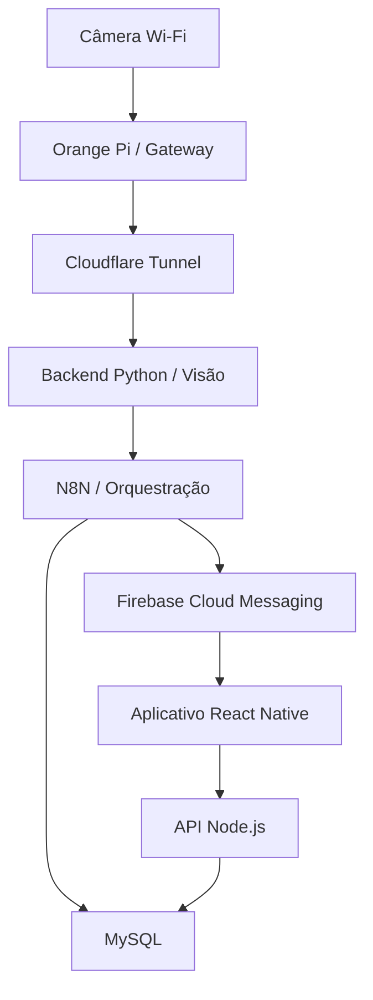

# PoolSafe - Fonte da Verdade do Projeto

> Documento técnico canônico para orientar o desenvolvimento e a integração dos componentes do PoolSafe.

**Última consolidação:** 18 de setembro de 2026  
**Escopo desta versão:** arquitetura geral, infraestrutura existente, aplicativo mobile e API de aplicação.

## 1. Finalidade e uso

Este documento descreve o estado vigente do PoolSafe e deve ser utilizado como referência por integrantes do projeto, agentes de desenvolvimento e futuras documentações técnicas.

Ele reúne:

- componentes já implementados e validados;
- decisões arquiteturais aprovadas, mesmo quando ainda não implementadas;
- pendências conhecidas que afetam o desenvolvimento;
- fronteiras de responsabilidade entre os sistemas.

Detalhes históricos e alternativas que não fazem parte da arquitetura vigente ficam fora deste documento. Em caso de divergência, prevalece a seguinte ordem:

1. decisões confirmadas pela equipe após a data desta consolidação;
2. este documento;
3. documentações técnicas vivas da infraestrutura;
4. texto acadêmico do TC2;
5. documentos anteriores.

Os estados utilizados são:

- **Implementado:** existe e foi validado no ambiente do projeto;
- **Decidido:** é uma definição oficial, mas pode ainda depender de implementação;
- **Pendente:** faz parte do escopo ou exige decisão, implementação ou validação futura.

## 2. Visão geral do PoolSafe

O PoolSafe é um sistema acadêmico de apoio à prevenção de afogamentos em piscinas residenciais. O sistema utiliza visão computacional para identificar situações potencialmente associadas a risco e alertar responsáveis por meio de um aplicativo móvel.

Uma detecção do PoolSafe não confirma, por si só, a ocorrência de um afogamento. O sistema identifica comportamentos fora do padrão esperado no ambiente da piscina, como queda, agitação, submersão ou permanência em situação potencialmente perigosa, e emite um alerta para que uma pessoa responsável verifique o local.

O PoolSafe funciona como uma camada adicional de segurança e não substitui supervisão humana, barreiras físicas, cuidados preventivos ou atendimento de emergência.

### 2.1 Objetivos técnicos vigentes

- receber o vídeo de uma câmera instalada na residência;
- transportar o fluxo de forma privada até a infraestrutura em nuvem;
- processar imagens por visão computacional;
- validar temporalmente uma possível situação de risco;
- registrar eventos e alertas;
- entregar notificações push aos dispositivos associados;
- permitir que o usuário gerencie sua conta, monitoramento, preferências e histórico pelo aplicativo.

## 3. Escopo desta frente de desenvolvimento

Esta frente compreende dois projetos novos e independentes:

| Repositório | Responsabilidade | Estado |
|---|---|---|
| `poolsafe-app-frontend` | Aplicativo mobile em React Native | Decidido; repositório existente e vazio |
| `poolsafe-app-backend` | API Node.js consumida pelo aplicativo | Decidido; repositório existente e vazio |

O backend Python de visão computacional é outro projeto. Ele aparece neste documento somente como componente externo necessário para compreender a arquitetura e as integrações. Sua estrutura interna e seu desenvolvimento não pertencem a esta frente.

Também não fazem parte do código do aplicativo:

- processamento de vídeo;
- inferência do modelo de IA;
- administração da VPS;
- administração do MySQL;
- criação dos workflows internos do N8N;
- configuração do gateway Orange Pi e da rede Cloudflare.

## 4. Arquitetura vigente

O sistema está dividido em três ambientes principais:

1. **Residência:** câmera Wi-Fi e Orange Pi Zero 3;
2. **Nuvem:** rede privada Cloudflare e VPS Contabo;
3. **Dispositivo do usuário:** aplicativo React Native e entrega de mensagens pelo Firebase Cloud Messaging.



O fluxo de vídeo e detecção é separado do fluxo de interação do aplicativo:

- **Fluxo de detecção:** câmera -> gateway -> rede privada -> backend Python -> N8N -> MySQL e FCM -> aplicativo;
- **Fluxo de aplicação:** aplicativo -> API Node.js -> MySQL.

A API poderá participar de outras integrações quando isso for definido por contrato, mas o aplicativo não deve contornar a API para acessar componentes internos.

## 5. Fronteiras obrigatórias

Estas regras são canônicas:

1. O aplicativo se comunica com os dados do PoolSafe exclusivamente por meio da API Node.js.
2. O aplicativo não acessa o MySQL diretamente.
3. O aplicativo não acessa o N8N diretamente.
4. O aplicativo não se comunica diretamente com o backend Python.
5. O aplicativo não precisa conhecer detalhes de Contabo, Docker, Portainer, Orange Pi, câmera ou Cloudflare.
6. O Firebase Cloud Messaging é usado para entrega de notificações push, não como banco de dados da aplicação.
7. Firestore e Firebase Realtime Database não fazem parte da arquitetura.
8. O backend Python e a API Node.js são sistemas diferentes, com responsabilidades distintas.
9. Serviços internos devem se comunicar por redes e interfaces controladas, evitando exposição pública desnecessária.
10. Contratos, endpoints ou campos ainda não definidos não devem ser inventados durante a implementação.

## 6. Componentes e responsabilidades

### 6.1 Aplicativo mobile

**Estado:** Decidido; ainda não implementado.

O aplicativo é a interface do responsável com o PoolSafe. Suas capacidades funcionais atualmente estabelecidas são:

- cadastrar usuário;
- autenticar usuário;
- manter e encerrar sessão;
- consultar e atualizar dados permitidos da conta;
- controlar o monitoramento conforme as regras que serão definidas;
- configurar preferências de alerta;
- receber notificações de risco;
- consultar o histórico de alertas;
- visualizar detalhes e evidências disponíveis de um alerta;
- registrar o dispositivo e seu FCM Token;
- atualizar o backend quando o FCM Token for renovado;
- permitir navegação para o alerta correspondente ao abrir uma notificação.

O mapa de telas, as jornadas, o conteúdo mínimo e os critérios de aceite do MVP estão definidos em `docs/app-requirements.md`. As regras comportamentais e invariantes correspondentes estão consolidadas em `docs/domain-model.md`.

### 6.2 API Node.js

**Estado:** Decidido; ainda não implementado.

A API é a única fronteira de dados e regras de aplicação exposta ao aplicativo. Suas responsabilidades definidas são:

- cadastro e autenticação de usuários;
- autorização das operações;
- validação e normalização das requisições;
- gerenciamento da sessão do aplicativo;
- consulta e atualização dos dados permitidos do usuário;
- consulta do histórico e dos detalhes de alertas;
- gerenciamento de dispositivos associados;
- cadastro, substituição e invalidação de FCM Tokens;
- disponibilização das configurações de monitoramento e alerta;
- aplicação das regras de segurança e acesso aos dados;
- comunicação com o MySQL pela rede interna da infraestrutura.

O contrato HTTP do MVP, incluindo autenticação, endpoints, paginação, erros, webhook interno e payload de push, está definido em `docs/api-contract.md`. Permanecem pendentes o framework Node.js, o ORM ou cliente SQL, a geração do `openapi.yaml`, as migrations, os testes executáveis e a implementação.

### 6.3 Backend Python de visão computacional

**Estado:** Arquitetura decidida; desenvolvimento tratado em projeto separado.

Responsabilidades conhecidas:

- receber e decodificar o fluxo de vídeo;
- pré-processar frames com OpenCV;
- executar inferência com YOLOv11;
- rastrear indivíduos com ByteTrack;
- aplicar persistência temporal para reduzir detecções isoladas;
- consolidar eventos de risco;
- enviar eventos ao N8N por HTTP POST;
- tratar perda e reconexão do fluxo;
- aplicar timeout, retry e desacoplamento suficientes para que falhas de integração não interrompam a captura.

O critério inicial documentado para o protótipo considera confirmação da mesma pessoa em situação de risco durante cinco frames consecutivos. O limiar inicial de confiança documentado é de 60%. Ambos dependem de validação pelas métricas do modelo e podem ser ajustados pelo projeto de visão computacional.

### 6.4 N8N

**Estado:** Infraestrutura implementada; workflows definitivos pendentes.

O N8N é a camada de orquestração de eventos de detecção. Seu papel previsto é:

- receber eventos do backend Python;
- validar e processar o payload recebido;
- persistir os dados necessários no MySQL;
- localizar os dispositivos destinatários;
- solicitar ao FCM o envio das notificações;
- registrar o resultado do processamento e do envio.

A comunicação básica Webhook -> N8N -> MySQL já foi validada. Permanecem pendentes o workflow definitivo, o contrato final do webhook, a autenticação entre backend Python e N8N, retries, tratamento de erros, integração final com FCM e registros operacionais definitivos.

### 6.5 MySQL

**Estado:** Infraestrutura implementada; schema lógico do MVP definido e migrações pendentes.

O MySQL 8.4 é o banco relacional principal e permanece responsável pela persistência da aplicação. A infraestrutura atual contém:

- container `mysql` operacional;
- banco `poolsafe`;
- usuário de aplicação com privilégios limitados ao banco do projeto;
- volume persistente `mysql_data`;
- participação na rede Docker `poolsafe-network`;
- porta 3306 não publicada no host;
- acesso administrativo por túnel SSH.

O schema lógico do MVP está definido em `docs/database-schema.md`. Ele estabelece, entre outros pontos, `ACESSO_CAMERA` como relação muitos-para-muitos, sessões de monitoramento com uma ou várias câmeras, `DISPOSITIVO`, destinatários históricos de alertas, evidências separadas e rastreabilidade das entregas por FCM. O DDL, as migrações e a validação física dos índices ainda precisam ser implementados.

### 6.6 Firebase Cloud Messaging

**Estado:** Tecnologia decidida; integração final pendente.

O FCM será utilizado exclusivamente para mensageria push. Cada instalação autorizada do aplicativo deverá possuir um token associado ao dispositivo e ao destinatário adequado.

Regras estabelecidas:

- o aplicativo obtém o token e o envia à API após o fluxo apropriado de autenticação ou associação;
- a API persiste e gerencia o vínculo do token;
- a renovação do token deve ser detectada e enviada à API;
- tokens inválidos devem ser inativados ou removidos após confirmação de falha definitiva;
- o payload deve permitir identificar o alerta e navegar até o conteúdo correspondente;
- a entrega precisa ser validada com o app em primeiro plano, segundo plano e encerrado.

### 6.7 Gateway Orange Pi

**Estado:** Implementado e validado para a câmera de teste.

O Orange Pi Zero 3 executa Debian Bookworm Server e atua apenas como gateway de rede. Ele mantém o `cloudflared` como serviço do `systemd` e estabelece uma conexão de saída com a Cloudflare.

O gateway não executa:

- YOLOv11 ou ByteTrack;
- OpenCV ou processamento de vídeo;
- API Node.js;
- N8N;
- MySQL;
- Portainer.

O serviço do túnel está habilitado no boot, permaneceu ativo após reinicialização e restabeleceu automaticamente o caminho entre a VPS e a câmera.

### 6.8 Cloudflare

**Estado:** Implementado.

A conectividade privada utiliza Cloudflare Tunnel no gateway e Cloudflare One Client/WARP na VPS. Apenas o tráfego destinado à câmera é encaminhado pela rota privada definida para o projeto, preservando o tráfego normal da VPS.

A solução evita a publicação direta do stream da câmera e não exige portas de entrada abertas no roteador residencial. Tokens, identificadores de organização, credenciais e parâmetros sensíveis não devem ser registrados em arquivos versionados.

### 6.9 VPS Contabo e containers

**Estado:** Infraestrutura-base implementada.

A VPS principal utiliza Ubuntu 24.04 LTS, arquitetura x86_64, Docker Engine e Docker Compose. O ambiente possui aproximadamente 7,8 GiB de RAM e 96 GB de armazenamento.

Serviços atuais:

- Portainer Community Edition;
- MySQL 8.4;
- N8N;
- Cloudflare One Client/WARP no host.

Os futuros containers da API Node.js e do backend Python deverão ser definidos separadamente e conectados somente às redes e serviços necessários.

## 7. Estado validado da conectividade da câmera

A câmera disponível para os testes atuais é uma D-Link DCS-930L. Ela fornece vídeo por HTTP/MJPEG e não oferece RTSP.

O seguinte caminho foi validado de ponta a ponta:

```text
VPS Contabo
-> Cloudflare One / WARP
-> Cloudflare Tunnel
-> Orange Pi Zero 3
-> câmera D-Link
-> stream HTTP/MJPEG
```

Foram validados:

- alcance da câmera a partir da VPS;
- conexão TCP;
- resposta HTTP;
- recebimento contínuo do stream MJPEG;
- recuperação automática do túnel após reboot do gateway.

A câmera de teste demonstra a viabilidade da conectividade privada, mas não altera o requisito do sistema definitivo. O teste com câmera RTSP e a validação de transporte, estabilidade, reconexão e latência do fluxo RTSP permanecem pendentes.

## 8. Modelo de domínio conceitual

O modelo abaixo é conceitual e serve para alinhar linguagem e responsabilidades. Ele não substitui o schema lógico em `docs/database-schema.md` nem o futuro contrato da API.

| Conceito | Significado atual |
|---|---|
| Usuário | Pessoa responsável que possui conta e autorização para acessar recursos do PoolSafe |
| Dispositivo | Instalação autorizada do aplicativo associada a tokens e metadados necessários |
| FCM Token | Identificador renovável usado para entregar notificações a uma instalação |
| Câmera | Origem de vídeo vinculada ao ambiente monitorado |
| Acesso à câmera | Autorização administrativa entre usuário e câmera, materializada por `ACESSO_CAMERA` |
| Monitoramento | Sessão compartilhada que agrupa uma ou várias câmeras e mantém o estado de acompanhamento |
| Alerta | Evento de possível risco confirmado pelas regras do pipeline |
| Destinatário do alerta | Usuário que possuía acesso ativo à câmera no instante da detecção |
| Notificação | Comunicação lógica de um alerta a um usuário, com entregas rastreadas por dispositivo |
| Log | Registro técnico ou de auditoria sobre ações e processamento do sistema |
| Evidência | Frame ou referência ao conteúdo associado ao momento da detecção |

As cardinalidades, os estados persistidos e a política inicial de retenção estão fechados em `docs/database-schema.md`. Os agregados, comportamentos, comandos, consultas, autorizações e invariantes estão definidos em `docs/domain-model.md`.

## 9. Fluxos funcionais canônicos

### 9.1 Cadastro e autenticação

1. O usuário informa os dados pelo aplicativo.
2. O aplicativo envia a requisição à API.
3. A API valida os dados e aplica as regras de autenticação.
4. A API persiste ou consulta os dados no MySQL.
5. O aplicativo mantém somente os dados de sessão necessários em armazenamento seguro.

### 9.2 Registro e renovação do dispositivo

1. O aplicativo obtém permissão para notificações conforme a plataforma.
2. O aplicativo obtém o FCM Token.
3. O token é enviado à API dentro de um contexto autenticado.
4. A API cria ou atualiza a associação com o dispositivo.
5. Quando o Firebase renovar o token, o aplicativo envia o novo valor à API.

### 9.3 Geração e entrega de alerta

1. O backend Python identifica e confirma uma possível situação de risco.
2. O backend envia o evento ao N8N.
3. O N8N valida e persiste os dados necessários.
4. O N8N identifica os dispositivos destinatários.
5. O N8N solicita o envio ao FCM.
6. O FCM entrega a notificação ao aplicativo.
7. Ao abrir a notificação, o aplicativo navega para o alerta correspondente e consulta os dados autorizados pela API.

### 9.4 Consulta ao histórico

1. O aplicativo solicita o histórico à API com autenticação válida.
2. A API aplica autorização, filtros e paginação.
3. A API consulta o MySQL.
4. O aplicativo apresenta a lista e permite abrir os detalhes disponíveis.

## 10. Stack decidida para o aplicativo

**Estado:** Decidido; versões exatas serão fixadas pelo projeto e pelo lockfile.

- Expo com Development Build;
- React Native;
- TypeScript em modo estrito;
- Expo Router;
- NativeWind em versão estável compatível com o projeto;
- TanStack Query para estado remoto e cache de dados da API;
- React Hook Form para formulários;
- Zod para schemas e validação;
- Expo SecureStore para dados sensíveis de sessão;
- React Native Firebase Messaging para integração com FCM.

Regras de adoção:

- o projeto não deve depender do Expo Go, pois a mensageria utiliza integração nativa;
- versões devem ser compatíveis entre si e instaladas conforme as recomendações do Expo;
- nenhuma dependência adicional deve ser incluída sem necessidade identificada;
- estado recebido da API deve permanecer separado do estado local de interface;
- uma biblioteca adicional de estado global somente será adotada se houver necessidade concreta;
- tokens de sessão não devem ser armazenados em AsyncStorage comum.

## 11. Stack de implementação da API ainda a fechar

A linguagem e o ambiente da API estão decididos como Node.js com TypeScript, e o comportamento HTTP está fechado em `docs/api-contract.md`. Antes do bootstrap devem ser definidos:

- framework HTTP;
- hash de senha com Argon2id;
- ORM, query builder ou cliente SQL;
- migrations;
- implementação da validação do contrato aprovado;
- geração e manutenção do `openapi.yaml`;
- testes unitários, de integração e de contrato;
- logs, observabilidade e correlação de requisições;
- rate limiting e proteções dos endpoints públicos;
- política de CORS quando aplicável;
- estratégia de deploy e atualização pelo Portainer.

Senhas nunca devem ser persistidas em texto simples. Segredos e credenciais devem ser fornecidos por mecanismos de ambiente ou cofre apropriado e nunca versionados.

## 12. Segurança e privacidade

As seguintes regras são obrigatórias:

- não incluir senhas, tokens, chaves privadas, service accounts, IP público da VPS ou credenciais em Git;
- não registrar segredos em documentação para agentes;
- não expor o MySQL à Internet;
- não expor o painel do N8N publicamente;
- usar comunicação HTTPS para a API exposta ao aplicativo;
- armazenar credenciais de usuário apenas como hash seguro;
- armazenar dados sensíveis de sessão do app em SecureStore;
- aplicar autenticação e autorização na API para cada recurso protegido;
- validar todos os dados recebidos em limites de confiança;
- retornar ao aplicativo somente os dados necessários;
- evitar dados sensíveis e tokens completos em logs;
- tratar imagens e frames de evidência como dados sensíveis;
- definir retenção, exclusão e autorização de acesso às evidências;
- manter dependências e imagens de container atualizadas de forma controlada.

A infraestrutura atual utiliza autenticação SSH por chave, login SSH por senha desabilitado, acesso direto de root desabilitado e UFW com política restritiva de entrada. O Portainer permanece acessível por HTTPS na porta administrativa configurada e ainda requer revisão de endurecimento final.

## 13. Requisitos não funcionais conhecidos

- **Segurança:** minimizar exposição pública e proteger identidades, tokens, imagens e credenciais.
- **Confiabilidade:** registrar eventos sem impedir que falhas secundárias interrompam o monitoramento.
- **Rastreabilidade:** manter relação entre detecção, alerta, notificação e logs.
- **Desempenho:** a meta acadêmica vigente para latência ponta a ponta é de até 8 segundos.
- **Processamento:** a referência atual do protótipo considera entrada mínima de 480p e fluxo mínimo de 15 FPS, sujeitos aos testes do backend de visão.
- **Disponibilidade:** gateway e serviços devem se recuperar automaticamente de reinicializações e falhas temporárias quando tecnicamente possível.
- **Usabilidade:** um alerta de risco deve ser claro, prioritário e acessível com poucas interações.
- **Manutenibilidade:** frontend, API, backend Python e orquestração permanecem desacoplados.

As metas de visão computacional e a medição completa de latência pertencem ao projeto de processamento, mas seus resultados influenciam os critérios de aceite das notificações.

## 14. Regras para agentes e implementação

Qualquer agente que trabalhe no projeto deve:

1. respeitar as fronteiras desta arquitetura;
2. consultar a documentação específica antes de alterar um contrato;
3. não inventar endpoints, entidades, campos, regras de negócio ou credenciais;
4. não trocar tecnologias decididas sem aprovação explícita;
5. justificar novas dependências;
6. implementar apenas o escopo solicitado;
7. usar TypeScript estrito nos projetos novos;
8. manter segredos fora do código e da documentação versionada;
9. produzir alterações pequenas e revisáveis;
10. atualizar documentação e testes quando alterar comportamento público;
11. distinguir mocks, protótipos e código de produção;
12. interromper e solicitar decisão quando encontrar ambiguidade que afete arquitetura, segurança ou contrato.

Este documento descreve o PoolSafe. Regras operacionais específicas do Antigravity devem ser derivadas para `.agents/rules/project-context.md`, sem copiar desnecessariamente todo o conteúdo.

## 15. Pendências conhecidas

### Produto e aplicativo

- validar notificações em foreground, background e app encerrado;
- validar deep link ou navegação interna a partir da notificação;
- definir versões mínimas do Android e, futuramente, do iOS.

### API e dados

- fechar a stack da API;
- implementar autenticação, sessão e recuperação conforme o contrato;
- gerar e validar o `openapi.yaml` a partir do contrato aprovado;
- implementar migrations, índices e constraints;
- definir paginação, filtros, erros e versionamento da API;
- implementar a retenção de 30 dias e o armazenamento dos frames definidos para o MVP;
- implementar no N8N a seleção transacional de destinatários e dispositivos;
- criar containers e pipeline de deploy da API.

### Integrações e infraestrutura

- substituir o workflow de teste do N8N pelo fluxo definitivo;
- autenticar a comunicação entre backend Python e N8N;
- integrar e validar o envio real pelo FCM;
- validar a câmera definitiva com RTSP;
- medir estabilidade, reconexão e latência do transporte RTSP;
- implantar os containers definitivos dos backends;
- revisar exposição administrativa do Portainer e regras finais de firewall;
- definir monitoramento, backups e recuperação da infraestrutura.

## 16. Documentação derivada recomendada

Este arquivo é a referência técnica ampla. O desenvolvimento deve derivar documentos menores e focados:

```text
.agents/rules/project-context.md
docs/architecture.md
docs/app-requirements.md
docs/design-system.md
docs/database-schema.md
docs/api-contract.md
docs/domain-model.md
docs/security.md
```

- `project-context.md`: visão curta, stack, fronteiras e regras permanentes para o agente;
- `app-requirements.md`: MVP, telas, jornadas e critérios de aceite;
- `design-system.md`: identidade visual, tokens e componentes de interface;
- `database-schema.md`: tabelas, relacionamentos, índices e retenção;
- `api-contract.md`: endpoints, schemas, erros, autenticação e versionamento;
- `domain-model.md`: agregados, comportamentos, comandos, consultas e invariantes;


## 17. Documentos-base desta consolidação

- `TCII_POOLSAFE_.pdf`;
- `PoolSafe_Infra_Gateway_OrangePi_ATUALIZADO_2026-09-12_FINAL(1).md`;
- `PoolSafe_Infra_Contabo_Fase6_concluida(3).md`;
- decisões confirmadas para a frente de aplicativo e API até 18 de setembro de 2026.
