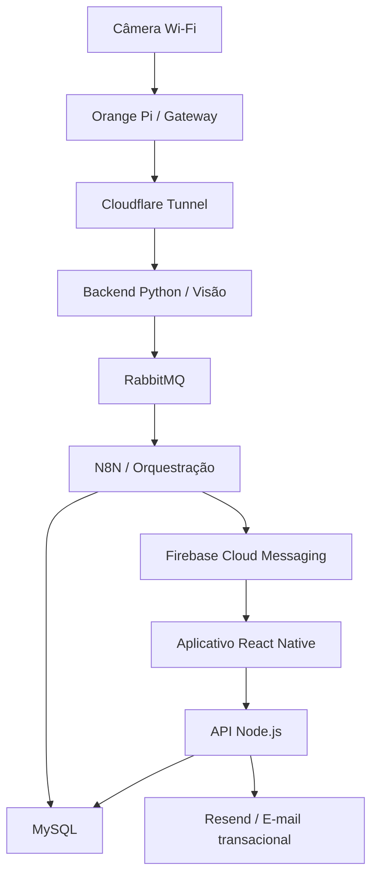

# PoolSafe — Fonte da Verdade do Projeto

> Documento técnico canônico para orientar o desenvolvimento, a integração e a documentação do PoolSafe.

**Última consolidação:** 26 de setembro de 2026  
**Escopo desta versão:** arquitetura geral, infraestrutura existente, mensageria, aplicativo mobile, API Node.js, persistência MySQL e estado das fatias de implementação.

## 1. Finalidade e uso

Este documento descreve o estado vigente do PoolSafe. Ele deve ser utilizado como referência por integrantes do projeto, agentes de desenvolvimento e futuras documentações técnicas.

Ele reúne:

- componentes implementados e validados;
- decisões arquiteturais aprovadas, mesmo quando ainda não implementadas;
- pendências conhecidas;
- fronteiras de responsabilidade entre os sistemas;
- estado atual do desenvolvimento do aplicativo, da API e do banco.

Em caso de divergência, prevalece a seguinte ordem:

1. decisões confirmadas pela equipe depois desta consolidação;
2. este documento;
3. contratos e documentos técnicos específicos do projeto;
4. documentações vivas da infraestrutura;
5. texto acadêmico do TC2;
6. documentos anteriores.

Os estados empregados neste arquivo são:

- **Implementado:** existe e foi validado no ambiente do projeto;
- **Decidido:** é uma definição oficial, mas ainda depende de implementação ou validação;
- **Pendente:** pertence ao escopo ou exige decisão, implementação ou teste futuro.

## 2. Visão geral

O PoolSafe é um sistema acadêmico de apoio à prevenção de afogamentos em piscinas residenciais. O sistema utiliza visão computacional para identificar situações potencialmente associadas a risco e alertar responsáveis por meio de um aplicativo móvel.

Uma detecção não confirma, isoladamente, a ocorrência de afogamento. O PoolSafe procura comportamentos fora do padrão esperado no ambiente da piscina, como queda, agitação, submersão ou permanência em condição potencialmente perigosa, e solicita a verificação humana do local.

O PoolSafe constitui uma camada adicional de segurança. Ele não substitui supervisão humana, barreiras físicas, cuidados preventivos ou atendimento de emergência.

### 2.1 Objetivos técnicos vigentes

- receber vídeo de uma câmera instalada na residência;
- transportar o fluxo de forma privada até a infraestrutura em nuvem;
- processar imagens por visão computacional;
- validar temporalmente uma possível situação de risco;
- desacoplar a produção e o consumo de eventos de detecção;
- registrar eventos, evidências, destinatários e alertas;
- entregar notificações push;
- permitir que o usuário gerencie conta, sessão, monitoramento e histórico pelo aplicativo.

## 3. Repositórios e estado atual

| Repositório | Responsabilidade | Estado em 26/09/2026 |
|---|---|---|
| `poolsafe-app-frontend` | Aplicativo mobile React Native | Bootstrap, identidade visual, navegação, cadastro, login, restauração de sessão, renovação segura e logout implementados e validados no Android |
| `poolsafe-app-backend` | API Node.js consumida pelo aplicativo | Bootstrap, Prisma, migrations, banco local, autenticação e sessão implementados e validados |

O backend Python de visão computacional é um projeto independente. Ele integra a arquitetura geral, mas não pertence aos repositórios do aplicativo e da API.

Também permanecem separados:

- workflows do N8N;
- RabbitMQ;
- configuração do Firebase;
- infraestrutura da VPS;
- gateway Orange Pi;
- processamento de vídeo e treinamento do modelo.

## 4. Arquitetura vigente

O sistema está dividido em três ambientes:

1. **Residência:** câmera Wi-Fi e Orange Pi Zero 3;
2. **Nuvem:** Cloudflare, VPS Contabo, processamento, mensageria, orquestração, API e banco;
3. **Dispositivo do usuário:** aplicativo React Native e entrega de mensagens pelo Firebase Cloud Messaging.



Os fluxos permanecem separados:

- **Detecção e alerta:** câmera → gateway → Cloudflare → backend Python → RabbitMQ → N8N → MySQL/FCM → aplicativo;
- **Aplicação:** aplicativo → API Node.js → MySQL;
- **E-mail transacional:** aplicativo → API Node.js → Resend → caixa de e-mail do usuário.

### 4.1 Estado da mensageria RabbitMQ

O RabbitMQ foi aprovado como intermediário entre o backend Python e o N8N. Essa decisão substitui, na arquitetura-alvo, o acoplamento direto por HTTP entre o produtor de visão computacional e o workflow de orquestração.

Objetivos da adoção:

- evitar que uma indisponibilidade temporária do N8N interrompa o processamento de vídeo;
- permitir confirmação de consumo e reprocessamento controlado;
- absorver picos curtos de eventos;
- separar produção, transporte e consumo dos eventos de detecção;
- preparar retries e fila de mensagens não processadas.

**Estado:** decidido, ainda não implementado. Permanecem pendentes instalação, topologia de exchange/queue, política de confirmação, retries, dead-letter queue, segurança e testes. O broker deverá permanecer interno à infraestrutura e não deve ser exposto publicamente.

### 4.2 Estado do serviço de e-mail

O provedor escolhido para e-mails transacionais é o **Resend**, associado a um domínio próprio a ser obtido por meio do GitHub Education.

Usos previstos:

- confirmação de endereço de e-mail;
- recuperação e redefinição de senha;
- comunicações transacionais indispensáveis à conta.

**Estado:** decidido, ainda não implementado. A ativação depende da liberação do benefício do domínio, da configuração DNS e da validação do domínio no Resend. O cadastro atualmente implementado ainda não envia mensagem de confirmação nem exige verificação de e-mail. Contrato, estado do usuário e fluxo de confirmação deverão ser revisados antes dessa funcionalidade entrar em produção.

## 5. Fronteiras obrigatórias

1. O aplicativo acessa dados do PoolSafe exclusivamente pela API Node.js.
2. O aplicativo não acessa MySQL, N8N, RabbitMQ ou backend Python diretamente.
3. O aplicativo não precisa conhecer detalhes de Contabo, Docker, Orange Pi, câmera ou Cloudflare.
4. O Firebase Cloud Messaging é utilizado para push, não como banco da aplicação.
5. Firestore e Firebase Realtime Database não fazem parte da arquitetura.
6. O backend Python e a API Node.js são sistemas distintos.
7. O backend Python publica eventos no RabbitMQ; o N8N os consome e orquestra o fluxo de alerta.
8. E-mails de conta devem partir de um fluxo controlado pela API, sem expor credenciais do provedor ao aplicativo.
9. Serviços internos devem utilizar redes e interfaces controladas.
10. Contratos ou campos não definidos não devem ser inventados durante a implementação.

## 6. Componentes e responsabilidades

### 6.1 Aplicativo mobile

**Estado:** Fatias 1 e 2 concluídas para o ambiente local Android.

Implementado e validado:

- Expo com Development Build e execução no emulador Android;
- navegação pública e autenticada com Expo Router;
- identidade visual, tema inicial e componentes fundamentais;
- formulários de cadastro e login com React Hook Form e Zod;
- integração real com a API local;
- armazenamento de access e refresh tokens no Expo SecureStore;
- restauração de sessão após encerramento forçado do aplicativo;
- renovação coordenada de token em modo single-flight;
- consulta autenticada de `/users/me`;
- logout com revogação remota e limpeza local;
- proteção contra retorno indevido a telas autenticadas;
- tratamento de Problem Details e erros de campos;
- validação do formulário com teclado virtual em tela compacta;
- testes automatizados do fluxo de autenticação e auditoria de logs.

Ainda pendente:

- recuperação de senha;
- confirmação de e-mail;
- edição de perfil e alteração de senha;
- dados reais da Home;
- câmeras, monitoramento e alertas;
- registro de dispositivo e FCM Token;
- notificações em foreground, background e aplicativo encerrado;
- tema claro e refinamentos finais de acessibilidade.

### 6.2 API Node.js

**Estado:** persistência inicial, autenticação e sessão implementadas localmente.

A API utiliza Node.js 24 LTS, TypeScript, NestJS, Prisma 7 e MySQL 8.4. Estão implementados:

- validação de ambiente;
- tratamento global de erros em Problem Details;
- logging estruturado com ocultação de credenciais;
- rate limiting;
- Swagger/OpenAPI;
- Prisma Client com adapter MariaDB/MySQL;
- cadastro de usuário;
- login;
- access token JWT RS256 com validade de 15 minutos;
- refresh token opaco, rotativo e com validade absoluta de 30 dias;
- consulta de usuário e sessão em toda rota protegida;
- `GET /api/v1/users/me`;
- logout com revogação imediata;
- Argon2id para senhas;
- proteção contra enumeração de conta;
- rotação transacional com bloqueio `SELECT ... FOR UPDATE`;
- retenção do hash atual e do imediatamente anterior para detecção segura de reutilização;
- testes unitários, integração e validação OpenAPI.

Rotas atualmente implementadas para identidade:

- `POST /api/v1/auth/register`;
- `POST /api/v1/auth/login`;
- `POST /api/v1/auth/refresh`;
- `POST /api/v1/auth/logout`;
- `GET /api/v1/users/me`.

Recuperação de senha, confirmação de e-mail e os demais módulos funcionais continuam pendentes.

### 6.3 Backend Python de visão computacional

**Estado:** arquitetura definida; implementação tratada separadamente.

Responsabilidades:

- receber e decodificar o fluxo de vídeo;
- pré-processar frames com OpenCV;
- executar inferência com YOLOv11;
- rastrear indivíduos com ByteTrack;
- aplicar persistência temporal;
- consolidar eventos de risco;
- publicar eventos no RabbitMQ;
- tratar perda e reconexão do stream sem interromper permanentemente o serviço.

O critério inicial do protótipo considera confirmação da mesma pessoa em situação de risco durante cinco frames consecutivos, com limiar inicial de confiança de 60%. Esses valores dependem de validação experimental.

### 6.4 RabbitMQ

**Estado:** componente aprovado e pendente de implantação.

O RabbitMQ será o broker de mensagens entre Python e N8N. A confirmação de publicação, consumo, retries, idempotência e tratamento de mensagens problemáticas deverá ser definida em conjunto com o contrato do evento de visão.

### 6.5 N8N

**Estado:** infraestrutura implementada; workflow definitivo pendente.

O N8N deverá:

- consumir eventos do RabbitMQ;
- validar o payload;
- persistir alertas e registros relacionados;
- localizar destinatários e dispositivos;
- solicitar ao FCM o envio das notificações;
- registrar resultados e falhas.

A comunicação básica Webhook → N8N → MySQL já foi validada como prova de infraestrutura, mas não representa mais o transporte definitivo entre Python e N8N.

### 6.6 MySQL e Prisma

**Estado:** schema implementado e validado no ambiente local; implantação na VPS pendente.

O MySQL 8.4 local de desenvolvimento é executado por Docker Compose, vinculado apenas a `127.0.0.1:3307`, com banco principal e banco shadow separados.

O Prisma representa as 15 tabelas do domínio:

1. `usuario`;
2. `camera`;
3. `dispositivo`;
4. `sessao_autenticacao`;
5. `token_recuperacao_senha`;
6. `acesso_camera`;
7. `monitoramento`;
8. `monitoramento_camera`;
9. `evento_monitoramento`;
10. `alerta`;
11. `evidencia_alerta`;
12. `alerta_destinatario`;
13. `notificacao`;
14. `entrega_notificacao`;
15. `log_sistema`.

O histórico possui duas migrations:

- migration inicial das 15 tabelas, constraints e índices;
- migration incremental que adiciona `token_hash_anterior` à sessão autenticada.

No banco local existem as 15 tabelas de domínio e a tabela interna `_prisma_migrations`. Foram validados InnoDB, `utf8mb4_0900_ai_ci`, FKs, índices, constraints `CHECK`, rollback transacional e ausência de drift.

O arquivo `001_poolsafe_schema_inicial.sql` permanece como referência histórica do DDL aprovado, mas não é mais o mecanismo de implantação. O repositório da API e suas migrations são a fonte executável da evolução do banco.

Na VPS já existem o container MySQL, o banco `poolsafe`, o usuário restrito, o volume persistente e a rede interna. As migrations ainda não foram aplicadas nesse ambiente.

### 6.7 Firebase Cloud Messaging

**Estado:** tecnologia decidida; integração pendente.

O FCM será usado exclusivamente para push. O aplicativo deverá registrar a instalação e o token pela API, atualizar o vínculo quando o token mudar e tratar abertura de alertas nos diferentes estados do app.

### 6.8 Gateway Orange Pi e Cloudflare

**Estado:** implementados e validados com a câmera de teste.

O Orange Pi Zero 3 executa Debian Bookworm Server e atua como gateway de rede. O `cloudflared` funciona como serviço do `systemd`, inicia no boot e restabelece a rota privada após reinicialização.

A VPS utiliza Cloudflare One Client/WARP para alcançar a rede da câmera. A câmera D-Link DCS-930L de teste fornece HTTP/MJPEG. Conexão TCP, resposta HTTP e stream contínuo foram validados a partir da VPS. A validação com câmera RTSP definitiva permanece pendente.

### 6.9 VPS Contabo

**Estado:** infraestrutura-base implementada.

A VPS utiliza Ubuntu 24.04 LTS, Docker Engine e Docker Compose. Serviços existentes:

- Portainer Community Edition;
- MySQL 8.4;
- N8N;
- Cloudflare One Client/WARP.

Permanecem pendentes:

- container da API Node.js;
- container do backend Python;
- RabbitMQ;
- aplicação das migrations Prisma;
- integração FCM;
- pipeline de deploy;
- endurecimento e observabilidade finais.

## 7. Estado validado da conectividade da câmera

O caminho validado atualmente é:

```text
VPS Contabo
→ Cloudflare One / WARP
→ Cloudflare Tunnel
→ Orange Pi Zero 3
→ câmera D-Link
→ stream HTTP/MJPEG
```

A câmera antiga demonstra a viabilidade da conectividade privada, mas não substitui a validação futura do fluxo RTSP definitivo.

## 8. Modelo conceitual

| Conceito | Significado |
|---|---|
| Usuário | Responsável com conta e autorização para acessar recursos |
| Sessão autenticada | Período de autenticação revogável associado ao par de tokens |
| Dispositivo | Instalação autorizada do aplicativo |
| Câmera | Origem de vídeo vinculada ao ambiente monitorado |
| Acesso à câmera | Autorização entre usuário e câmera |
| Monitoramento | Sessão que agrupa uma ou várias câmeras |
| Evento de visão | Mensagem técnica publicada pelo Python no RabbitMQ |
| Alerta | Possível risco confirmado pelas regras do pipeline |
| Destinatário | Usuário autorizado no instante da detecção |
| Evidência | Frame associado à detecção |
| Notificação | Comunicação lógica entregue por um ou mais dispositivos |

## 9. Fluxos canônicos

### 9.1 Cadastro, login e sessão — implementado localmente

1. O usuário envia os dados pelo aplicativo.
2. A API normaliza e valida a requisição.
3. A senha é protegida com Argon2id.
4. A API cria ou consulta usuário e sessão no MySQL.
5. Access e refresh tokens são devolvidos ao aplicativo.
6. O aplicativo mantém os tokens no SecureStore.
7. O access token é renovado de forma coordenada quando necessário.
8. A API verifica usuário e sessão em todas as rotas protegidas.
9. O logout revoga a sessão e remove os dados locais.

### 9.2 Recuperação e confirmação por e-mail — pendente

1. O usuário inicia a ação no aplicativo.
2. A API cria um segredo de uso único e armazena somente seu hash.
3. A API solicita ao Resend o envio pelo domínio verificado.
4. O usuário utiliza link ou código dentro da validade definida.
5. A API valida o segredo, conclui a operação e revoga sessões quando aplicável.

### 9.3 Geração e entrega de alerta — arquitetura decidida

1. O Python confirma uma possível situação de risco.
2. O evento é publicado no RabbitMQ.
3. O N8N consome e valida a mensagem.
4. O N8N persiste alerta, evidência e destinatários.
5. O N8N solicita o envio ao FCM.
6. O aplicativo recebe a notificação.
7. Ao abrir, o app consulta o conteúdo autorizado pela API.

## 10. Stack do aplicativo

- Expo com Development Build;
- React Native;
- TypeScript estrito;
- Expo Router;
- NativeWind;
- TanStack Query;
- React Hook Form;
- Zod;
- Expo SecureStore;
- React Native Firebase Messaging, a integrar na fatia própria;
- `expo-dev-client`.

Tokens não podem ser persistidos em AsyncStorage. Dados remotos e estado local de interface permanecem separados. Não foi adotada biblioteca adicional de estado global.

## 11. Stack da API

- Node.js 24 LTS;
- NestJS;
- TypeScript estrito;
- Prisma 7 e MySQL 8.4;
- Argon2id;
- JWT RS256 e refresh token opaco;
- Pino HTTP Logger;
- NestJS Throttler;
- Problem Details RFC 9457;
- Swagger/OpenAPI;
- Docker multi-stage.

## 12. Segurança e privacidade

- nenhuma senha, token, chave privada, service account, IP público ou credencial deve ser versionado;
- tokens de sessão ficam no SecureStore;
- a API nunca registra payloads completos de autenticação;
- o MySQL, N8N e RabbitMQ não devem ser expostos ao aplicativo ou à Internet;
- a API pública deverá utilizar HTTPS;
- senhas usam Argon2id;
- refresh tokens são armazenados somente como hash;
- a rotação usa transação e bloqueio pessimista;
- respostas não expõem stack, SQL ou topologia interna;
- evidências são dados sensíveis e exigem autorização;
- e-mails de recuperação e confirmação não devem revelar a existência de uma conta;
- credenciais do Resend devem existir apenas no ambiente seguro da API;
- SSH da VPS utiliza chave, sem login direto de root e sem senha.

## 13. Requisitos não funcionais

- **Segurança:** proteção de identidades, tokens, imagens e credenciais;
- **Confiabilidade:** falhas secundárias não devem interromper o monitoramento;
- **Rastreabilidade:** relação entre detecção, evento, alerta, notificação e logs;
- **Desempenho:** meta acadêmica de até 8 segundos para a latência ponta a ponta;
- **Disponibilidade:** recuperação automática de falhas temporárias quando possível;
- **Usabilidade:** alerta claro e acessível com poucas interações;
- **Manutenibilidade:** aplicativo, API, Python, RabbitMQ e N8N desacoplados.

## 14. Regras de implementação

1. Respeitar as fronteiras desta arquitetura.
2. Consultar os contratos antes de alterar comportamentos públicos.
3. Não inventar endpoints, campos ou credenciais.
4. Não trocar tecnologias decididas sem aprovação.
5. Justificar dependências novas.
6. Implementar somente o escopo solicitado.
7. Manter segredos fora do código e da documentação.
8. Produzir alterações pequenas, testadas e revisáveis.
9. Distinguir claramente implementado, simulado e planejado.
10. Parar quando uma ambiguidade afetar arquitetura, segurança ou dados.

## 15. Estado das fatias verticais

| Fatia | Estado |
|---|---|
| Bootstrap técnico | Concluído |
| Identidade visual e componentes fundamentais | Concluída |
| Persistência, cadastro, login e sessão | Concluída localmente de ponta a ponta |
| Recuperação de acesso e conta | Próxima; depende parcialmente do serviço de e-mail |
| Home | Pendente |
| Câmeras | Pendente |
| Monitoramento | Pendente |
| Histórico e detalhes de alerta | Pendente |
| Dispositivo e FCM Token | Pendente |
| Notificações | Pendente |
| Definições, temas e refinamentos | Parcial/Pendente |
| Integração e demonstração completa | Pendente |

## 16. Pendências prioritárias

### Aplicativo e conta

- recuperação de senha;
- confirmação de e-mail quando domínio e Resend estiverem disponíveis;
- perfil e alteração de senha;
- Home, câmeras, monitoramento e alertas;
- FCM e notificações.

### API e dados

- endpoints posteriores à autenticação;
- implantação da API na VPS;
- aplicação das migrations com `prisma migrate deploy`;
- integração segura com Resend;
- geração final e versionada do OpenAPI;
- retenção e expurgo de evidências.

### Pipeline de detecção

- implantação do RabbitMQ;
- contrato definitivo do evento Python → RabbitMQ → N8N;
- workflow definitivo do N8N;
- integração FCM;
- câmera RTSP e testes de latência;
- containers definitivos do Python e da API;
- backups, observabilidade e recuperação.

## 17. Documentos-base desta consolidação

- `TCII_POOLSAFE_.pdf`;
- `PoolSafe_Infra_Gateway_OrangePi_ATUALIZADO_2026-09-12_FINAL(1).md`;
- `PoolSafe_Infra_Contabo_Fase6_concluida(3).md`;
- `database-schema.md`;
- `domain-model.md`;
- `api-contract.md`;
- `app-requirements.md`;
- `design-system.md`;
- `PoolSafe_Plano_de_Fatias_Verticais.md`;
- relatórios de conclusão das Etapas 2A, 2B e 2C;
- decisões confirmadas até 26 de setembro de 2026.
