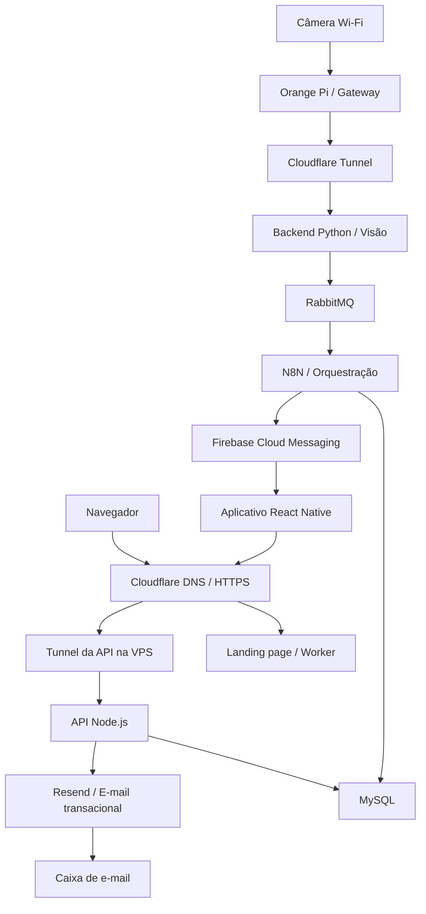

# PoolSafe — Fonte da Verdade do Projeto

> Documento técnico canônico para orientar o desenvolvimento, a integração e a documentação do PoolSafe.

**Última consolidação:** 18 de outubro de 2026  
**Escopo desta versão:** arquitetura geral, domínio público e camada Cloudflare, infraestrutura da VPS, mensageria planejada, aplicativo mobile, API Node.js em produção, CI/CD, GHCR, Portainer, release Android assinado, e-mail transacional, persistência MySQL, conectividade das câmeras, histórico de alertas, evidências, prontidão Android, identidade da instalação, token FCM e estado das fatias de implementação.

**Recorte desta atualização:** somente o checkpoint de entrada, consulta, retenção e expurgo de evidências, validado em 18/10/2026. Não consolida as Tasks da Fatia 9B nem declara seu encerramento. As demais referências de implementação dessa fatia preservam o marco anterior e devem ser acompanhadas pelo checklist vigente até a consolidação final.

## 1. Finalidade e uso

Este documento descreve o estado vigente do PoolSafe. Ele deve ser utilizado como referência por integrantes do projeto, agentes de desenvolvimento e futuras documentações técnicas.

Ele reúne:

- componentes implementados e validados;
- decisões arquiteturais aprovadas, mesmo quando ainda não implementadas;
- pendências conhecidas;
- fronteiras de responsabilidade entre os sistemas;
- estado atual do desenvolvimento do aplicativo, da API e do banco.

Em caso de divergência, prevalece a seguinte ordem:

1. decisões confirmadas pela equipe depois desta consolidação;
2. este documento;
3. contratos e documentos técnicos específicos do projeto;
4. documentações vivas da infraestrutura;
5. texto acadêmico do TC2;
6. documentos anteriores.

Os estados empregados neste arquivo são:

- **Implementado:** existe e foi validado no ambiente do projeto;
- **Decidido:** é uma definição oficial, mas ainda depende de implementação ou validação;
- **Pendente:** pertence ao escopo ou exige decisão, implementação ou teste futuro.

## 2. Visão geral

O PoolSafe é um sistema acadêmico de apoio à prevenção de afogamentos em piscinas residenciais. O sistema utiliza visão computacional para identificar situações potencialmente associadas a risco e alertar responsáveis por meio de um aplicativo móvel.

Uma detecção não confirma, isoladamente, a ocorrência de afogamento. O PoolSafe procura comportamentos fora do padrão esperado no ambiente da piscina, como queda, agitação, submersão ou permanência em condição potencialmente perigosa, e solicita a verificação humana do local.

O PoolSafe constitui uma camada adicional de segurança. Ele não substitui supervisão humana, barreiras físicas, cuidados preventivos ou atendimento de emergência.

### 2.1 Objetivos técnicos vigentes

- receber vídeo de uma câmera instalada na residência;
- transportar o fluxo de forma privada até a infraestrutura em nuvem;
- processar imagens por visão computacional;
- validar temporalmente uma possível situação de risco;
- desacoplar a produção e o consumo de eventos de detecção;
- registrar eventos, evidências, destinatários e alertas;
- entregar notificações push;
- oferecer uma presença pública segura para apresentação do projeto;
- enviar e-mails transacionais de conta por domínio próprio;
- permitir que o usuário gerencie conta, sessão, monitoramento e histórico pelo aplicativo.

## 3. Repositórios e estado atual

| Repositório | Responsabilidade | Estado em 11/10/2026 |
|---|---|---|
| `poolsafe-app-frontend` | Aplicativo mobile React Native | Funcionalidades das Fatias 1 a 8B implementadas; APK release assinado, apontado deterministicamente para a API pública e validado em aparelho físico contra o ambiente remoto |
| `poolsafe-app-backend` | API Node.js consumida pelo aplicativo | Módulos funcionais implementados; migrations aplicadas no MySQL remoto; validação e publicação de imagem automatizadas no GitHub Actions; API implantada pelo Portainer e saudável na VPS |
| `poolsafe-landing-page` | Apresentação pública do projeto | Landing page estática implementada, publicada em Cloudflare Workers e disponível em `https://poolsafe.app` |

O backend Python de visão computacional é um projeto independente. Ele integra a arquitetura geral, mas não pertence aos repositórios do aplicativo e da API.

Também permanecem separados:

- workflows do N8N;
- RabbitMQ;
- credencial de envio do Firebase e integração FCM do N8N;
- infraestrutura da VPS;
- gateway Orange Pi;
- processamento de vídeo e treinamento do modelo.

## 4. Arquitetura vigente

O sistema está dividido em quatro contextos principais:

1. **Residência:** câmera Wi-Fi e Orange Pi Zero 3;
2. **Borda e domínio público:** Cloudflare como DNS autoritativo, camada HTTPS/TLS, proxy, hospedagem da landing page, redirecionamentos e conectividade privada por Tunnel;
3. **Nuvem de aplicação:** VPS Contabo, processamento, mensageria, orquestração, API e banco;
4. **Dispositivo do usuário:** aplicativo React Native e entrega de mensagens pelo Firebase Cloud Messaging.



Os fluxos permanecem separados:

- **Detecção e alerta:** câmera → gateway → Cloudflare → backend Python → RabbitMQ → N8N → MySQL/FCM → aplicativo;
- **Conectividade da câmera:** frame confirmado no Python → heartbeat no RabbitMQ → N8N → atualização de `ultima_comunicacao_em` no MySQL → cálculo pela API;
- **Aplicação:** aplicativo → HTTPS/Cloudflare → Tunnel da VPS → API Node.js → MySQL;
- **E-mail transacional:** aplicativo → API Node.js → Resend → caixa de e-mail do usuário;
- **Apresentação pública:** navegador → Cloudflare DNS/HTTPS → landing page estática em Worker.

### 4.1 Camada Cloudflare e domínio público

O domínio `poolsafe.app` foi obtido na Name.com e utiliza nameservers da Cloudflare. A Cloudflare passou a concentrar o DNS autoritativo do domínio e ampliou seu papel no projeto para além do Tunnel já utilizado na rede residencial.

Responsabilidades atualmente implementadas:

- gerenciamento dos registros DNS de `poolsafe.app`;
- emissão e renovação automática de certificados TLS para os hostnames públicos;
- publicação da landing page estática em Cloudflare Workers com domínio personalizado;
- atendimento canônico da landing page em `https://poolsafe.app`;
- redirecionamento permanente de `https://www.poolsafe.app` para o domínio sem `www`, preservando caminho e parâmetros;
- registros DNS de autenticação do Resend para o subdomínio `send.poolsafe.app`;
- transporte privado entre a VPS e a rede residencial por Cloudflare Tunnel e WARP;
- publicação da API em `https://api.poolsafe.app` por um Tunnel dedicado na VPS, sem abertura de porta pública para o processo Node.js.

A landing page possui finalidade institucional e acadêmica: apresentar o PoolSafe como projeto de TCC ainda em desenvolvimento. Ela não hospeda a API, não acessa o banco e não participa dos fluxos internos de monitoramento.

O HTTPS público é fornecido pela Cloudflare. Não foi adquirido certificado SSL separado na registradora. Novos subdomínios poderão ser direcionados a aplicações futuras por DNS, Worker ou Cloudflare Tunnel, conforme a natureza do serviço; isso não implica exposição direta de portas da VPS.

Na VPS, o conector `cloudflared` 2026.10.0 está instalado como serviço do `systemd`, habilitado para iniciar com o sistema e observado como `active`. O Tunnel `poolsafe-api-vps` aparece como saudável no painel da Cloudflare e encaminha `api.poolsafe.app` para `http://localhost:3000`. Os endpoints `/api/v1/health/live` e `/api/v1/health/ready` foram validados com `HTTP 200` tanto localmente na VPS quanto externamente por HTTPS.

**Estado:** DNS, HTTPS, landing page, domínio raiz, redirecionamento `www` e publicação da API por Tunnel implementados e validados. DNSSEC permanece como endurecimento futuro opcional. Serviços administrativos, como N8N e MySQL, continuam sem publicação direta na Internet.

### 4.2 Estado da mensageria RabbitMQ

O RabbitMQ foi aprovado como intermediário entre o backend Python e o N8N. Essa decisão substitui, na arquitetura-alvo, o acoplamento direto por HTTP entre o produtor de visão computacional e o workflow de orquestração.

Objetivos da adoção:

- evitar que uma indisponibilidade temporária do N8N interrompa o processamento de vídeo;
- permitir confirmação de consumo e reprocessamento controlado;
- absorver picos curtos de eventos;
- separar produção, transporte e consumo dos eventos de detecção;
- preparar retries e fila de mensagens não processadas.

**Estado:** decidido, ainda não implementado. Permanecem pendentes instalação, topologia de exchange/queue, política de confirmação, retries, dead-letter queue, segurança e testes. O broker deverá permanecer interno à infraestrutura e não deve ser exposto publicamente.

### 4.3 Estado do serviço de e-mail

O provedor de e-mails transacionais é o **Resend**, integrado à API Node.js pelo subdomínio verificado `send.poolsafe.app` e pela região de São Paulo (`sa-east-1`). O remetente vigente é `PoolSafe <nao-responda@send.poolsafe.app>`.

Usos previstos:

- confirmação de endereço de e-mail;
- recuperação e redefinição de senha;
- comunicações transacionais indispensáveis à conta.

SPF e DKIM foram configurados no DNS da Cloudflare. Foi adicionado DMARC inicial com política `p=none`, adequada para observação antes de políticas mais restritivas. A chave da API possui apenas permissão de envio e está restrita ao domínio; seu valor existe somente no ambiente privado do backend.

A recuperação de senha foi implementada de ponta a ponta. A API gera um código de uso único no formato visual `XXXX-XXXX`, armazena somente seu hash SHA-256, aplica validade inicial de 15 minutos e envia versões HTML e texto do e-mail pelo Resend. A redefinição protege a nova senha com Argon2id, consome o código atomicamente, revoga todas as sessões e invalida os dispositivos da conta. Solicitações de recuperação mantêm resposta pública genérica e limites por e-mail normalizado e IP.

**Estado:** domínio, DNS, envio transacional e Fatia 3B implementados e validados com recebimento real de e-mail e redefinição no Android. A confirmação do endereço no cadastro permanece pendente e não altera, por enquanto, o comportamento atual de criação de conta e login.

### 4.4 Heartbeat e conectividade das câmeras

O estado de conexão da câmera permanece calculado, e não persistido. O MySQL mantém somente `camera.ultima_comunicacao_em`; a API compara esse instante com a janela operacional configurável de 90 segundos:

- `DESCONHECIDA`: a câmera nunca comunicou ou a referência não é confiável;
- `ONLINE`: a última comunicação ocorreu dentro da janela;
- `OFFLINE`: a câmera está administrativamente ativa e ultrapassou a janela;
- `INATIVA`: condição administrativa separada da conectividade.

**Decisão arquitetural:** o Python deverá publicar no RabbitMQ um heartbeat periódico por câmera, inicialmente a cada aproximadamente 30 segundos, somente quando houver confirmação real de captura ou decodificação do stream. O N8N continuará como orquestrador e atualizará `ultima_comunicacao_em` no MySQL, respeitando a regra de que esse instante somente avança.

O heartbeat deverá continuar mesmo quando o monitoramento estiver pausado. A pausa interrompe a análise de risco, não a verificação de disponibilidade da câmera. Mensagens atrasadas não podem reclassificar uma câmera como online; o consumidor deverá considerar o instante real de observação e rejeitar heartbeats antigos ou inválidos.

Não é necessário gravar uma transição para `OFFLINE` nem executar rotina periódica apenas para a consulta do estado. A API deriva o resultado no momento da requisição. Um watchdog agendado no N8N seria necessário somente para gerar notificações proativas de indisponibilidade.

**Decisão de escopo do MVP:** indisponibilidade de câmera será comunicada pela Home e pelas telas de câmeras. Push de câmera offline não será implementado nesta etapa. As notificações FCM continuam destinadas a possíveis situações de risco. Uma futura notificação operacional exigirá controle de transição e deduplicação, além de revisão do modelo atual, no qual `notificacao` está vinculada a um alerta.

**Estado:** arquitetura decidida; implementação pendente para o checkpoint do pipeline Python, RabbitMQ e N8N.

## 5. Fronteiras obrigatórias

1. O aplicativo acessa dados do PoolSafe exclusivamente pela API Node.js.
2. O aplicativo não acessa MySQL, N8N, RabbitMQ ou backend Python diretamente.
3. O aplicativo não precisa conhecer detalhes de Contabo, Docker, Orange Pi, câmera ou Cloudflare.
4. O Firebase Cloud Messaging é utilizado para push, não como banco da aplicação.
5. Firestore e Firebase Realtime Database não fazem parte da arquitetura.
6. O backend Python e a API Node.js são sistemas distintos.
7. O backend Python publica eventos de risco e heartbeats no RabbitMQ; o N8N os consome e orquestra os fluxos internos correspondentes.
8. E-mails de conta devem partir de um fluxo controlado pela API, sem expor credenciais do provedor ao aplicativo.
9. Serviços internos devem utilizar redes e interfaces controladas.
10. Contratos ou campos não definidos não devem ser inventados durante a implementação.

## 6. Componentes e responsabilidades

### 6.1 Aplicativo mobile

**Estado:** Fatias 1, 2, 3A, 3B, 4, 5, 6, 7, 8A, 8A.1, 8B e 9A concluídas no Android; o primeiro APK release foi validado em aparelho físico contra a API de produção.

Implementado e validado:

- Expo com Development Build e execução no emulador Android;
- navegação pública e autenticada com Expo Router;
- identidade visual, tema inicial e componentes fundamentais;
- formulários de cadastro e login com React Hook Form e Zod;
- integração real com a API local;
- armazenamento de access e refresh tokens no Expo SecureStore;
- restauração de sessão após encerramento forçado do aplicativo;
- renovação coordenada de token em modo single-flight;
- consulta autenticada de `/users/me`;
- logout com revogação remota e limpeza local;
- proteção contra retorno indevido a telas autenticadas;
- tratamento de Problem Details e erros de campos;
- validação do formulário com teclado virtual em tela compacta;
- testes automatizados do fluxo de autenticação e auditoria de logs;
- consulta e alteração do nome do perfil;
- alteração autenticada de senha com preservação da sessão atual;
- tela de conta integrada à API;
- Home autenticada com estado de monitoramento, resumo de câmeras, avisos, sincronização e alerta recente;
- diferenciação entre carregamento, vazio, erro sem dados e dados anteriores desatualizados;
- atualização manual da Home e validação de seus cenários com seeds do Prisma;
- aba de câmeras integrada à API com resumo de conectividade e listagem autorizada;
- detalhes da câmera com situação administrativa, conexão, monitoramento e última comunicação;
- apresentação de até 30 alertas recentes dos quais o usuário foi destinatário;
- estados de carregamento, vazio, erro, atualização manual e dados desatualizados nas telas de câmera;
- validação manual da Fatia 5 no Android com seeds para câmeras online, offline, desconhecidas, inativas, sem monitoramento, sem alertas e lista vazia;
- solicitação pública de recuperação com resposta genérica;
- tela para código, nova senha e confirmação, com retorno seguro ao Login;
- integração real de recuperação com Resend e domínio próprio;
- validação manual da Fatia 3B no Android, incluindo recebimento do e-mail, uso do código e novo login;
- tela autenticada de Controle de monitoramento, aberta acima da navegação por abas;
- consulta das sessões atuais e seleção explícita de uma ou várias câmeras elegíveis para iniciar uma sessão;
- pausa e encerramento da sessão completa mediante confirmação reforçada e reautenticação por senha;
- retomada de sessões pausadas sem senha, condicionada à disponibilidade das câmeras;
- composição imutável da sessão, sem desvinculação individual de câmeras; para mudar a composição, a sessão atual é encerrada e outra é criada;
- atualização confirmada pela API, sem estado otimista, com invalidação coordenada da Home, monitoramentos, lista e detalhes de câmeras;
- representação de sessões ativas e pausadas simultaneamente como `DEGRADADO / SESSIONS_MIXED`, exibida na Home como “Proteção parcial”;
- validação manual da Fatia 6 no Android;
- Histórico integrado à API, ordenado do alerta mais recente para o mais antigo e carregado de forma incremental;
- detalhes do alerta com severidade, data, câmera, local e situação da evidência;
- navegação para os detalhes pelo Histórico, pela Home e pelos alertas recentes das câmeras;
- consulta de alertas baseada no destinatário registrado no instante da detecção, preservando o histórico mesmo após eventual revogação posterior do acesso à câmera;
- carregamento autenticado da evidência somente quando necessário, com permanência temporária em memória e sem download, compartilhamento ou armazenamento local persistente;
- tratamento independente dos estados de evidência disponível, não capturada, expirada, removida ou temporariamente indisponível;
- validação manual da Fatia 7 no Android, incluindo paginação, navegação e apresentação das evidências;
- canal crítico Android com som provisório, vibração, diagnóstico de permissões e atalhos para configurações do sistema;
- botão de teste de alerta na área de Definições;
- Development Build instalado e executado em aparelho físico;
- validação física de volume de notificações, volume de alarmes, modo Silencioso e “Não Perturbe”;
- módulo Expo local em Kotlin para a capacidade nativa específica de alarme crítico;
- Foreground Service temporário do tipo `mediaPlayback`, iniciado somente durante o teste e não reiniciável automaticamente;
- reprodução local em loop pelo `MediaPlayer` com `USAGE_ALARM`, foco de áudio e duração máxima de 30 segundos;
- vibração nativa repetida classificada como alarme, com compatibilidade entre versões do Android;
- interrupção pela interface ou pela ação da notificação persistente, com liberação integral de player, vibração, foco de áudio, callbacks e serviço;
- sincronização do estado do alarme por evento nativo e nova consulta quando o aplicativo retorna ao primeiro plano;
- diagnóstico informativo de otimização de bateria e atalho para as configurações correspondentes, sem exigir exclusão automática;
- validação física do alarme com modo Silencioso e “Não Perturbe” ativos, tela bloqueada e fechamento da interface depois do início;
- confirmação de que o áudio utiliza o volume de Alarmes do aparelho e não o volume de notificações;
- aplicativo Android registrado no Firebase com o package `com.anonymous.poolsafeapp` e configuração nativa pelo `google-services.json`;
- UUID v4 da instalação persistido sob chave própria no Expo SecureStore e preservado pela limpeza da sessão no logout;
- obtenção do token FCM nativo por `Notifications.getDevicePushTokenAsync()` e observação de mudanças por `Notifications.addPushTokenListener()`;
- sincronização autenticada de dispositivo serializada, single-flight, latest-wins e com retentativa delimitada para falhas transitórias;
- distinção entre permissão concedida, negativa explícita e estado `undetermined`, sem apagar o token remoto enquanto o usuário ainda não decidiu;
- apresentação do estado de sincronização na área de Definições, sem expor o UUID completo ou o token bruto;
- validação do token nativo em aparelho Android real e inspeção dos registros de dispositivo no MySQL local;
- geração de APK standalone release assinado com certificado próprio do PoolSafe;
- URL de produção resolvida deterministicamente como `https://api.poolsafe.app/api/v1` quando `__DEV__ === false`, sem permitir contaminação por `.env` local;
- navegação, autenticação, chamadas à API remota e transições de tela validadas no APK instalado em aparelho físico;
- sincronização do token FCM confirmada no release após o cadastro das impressões SHA-1 e SHA-256 do certificado de assinatura no aplicativo Android do Firebase;
- 103 testes aprovados no backend no workflow da API e 113 testes aprovados no frontend na preparação final do release.

Ainda pendente:

- confirmação de e-mail;
- notificações remotas e acionamento da camada nativa em foreground, background e aplicativo encerrado;
- tela crítica interna durante o alarme e navegação pelo toque na notificação;
- validação de Doze, prioridade real do FCM e restrições de início do serviço quando o aplicativo ainda não estiver aberto;
- tema claro e refinamentos finais de acessibilidade.

O APK final da Fatia 9A utiliza o package `com.anonymous.poolsafeapp`, versionCode `1` e versionName `1.0.0`. O artefato possui SHA-256 `F54C8C9EC06E909F9EA5AA32B470E7D2B9B9864E3CD05B03E50E778197F0C4EC` e foi verificado pelo `apksigner` com APK Signature Scheme v2. O certificado release possui digest SHA-256 `dc62b7cf62ca16e7d1e1abfcc0b90a57953ace089a399ec59d38df5f69036224`.

A pasta nativa `android/` permanece ignorada no repositório. Por isso, a configuração local de assinatura em `android/app/build.gradle`, o `android/key.properties` e o `android/app/poolsafe-release.keystore` não são reproduzidos apenas por um clone do Git. Esses três arquivos foram preservados em backup externo criptografado e protegido por senha. O keystore não deve ser recriado ou substituído: versões futuras destinadas a atualizar a mesma instalação Android precisam conservar a identidade de assinatura.

### 6.2 API Node.js

**Estado:** persistência, autenticação, sessão, conta, recuperação de senha, Home, câmeras, monitoramentos, alertas, evidências e dispositivos implementados e implantados na VPS para consumo remoto.

A API utiliza Node.js 24 LTS, TypeScript, NestJS, Prisma 7 e MySQL 8.4. Estão implementados:

- validação de ambiente;
- tratamento global de erros em Problem Details;
- logging estruturado com ocultação de credenciais;
- rate limiting;
- Swagger/OpenAPI;
- Prisma Client com adapter MariaDB/MySQL;
- cadastro de usuário;
- login;
- access token JWT RS256 com validade de 15 minutos;
- refresh token opaco, rotativo e com validade absoluta de 30 dias;
- consulta de usuário e sessão em toda rota protegida;
- `GET /api/v1/users/me`;
- `PATCH /api/v1/users/me`;
- `PUT /api/v1/users/me/password`;
- `GET /api/v1/home`;
- `GET /api/v1/cameras`;
- `GET /api/v1/cameras/{cameraId}`;
- logout com revogação imediata;
- Argon2id para senhas;
- proteção contra enumeração de conta;
- rotação transacional com bloqueio `SELECT ... FOR UPDATE`;
- retenção do hash atual e do imediatamente anterior para detecção segura de reutilização;
- testes unitários, integração e validação OpenAPI.

Rotas atualmente implementadas para identidade:

- `POST /api/v1/auth/register`;
- `POST /api/v1/auth/login`;
- `POST /api/v1/auth/refresh`;
- `POST /api/v1/auth/logout`;
- `POST /api/v1/auth/forgot-password`;
- `POST /api/v1/auth/reset-password`;
- `GET /api/v1/users/me`;
- `PATCH /api/v1/users/me`;
- `PUT /api/v1/users/me/password`.

Rotas funcionais implementadas após identidade:

- `GET /api/v1/home`;
- `GET /api/v1/cameras`;
- `GET /api/v1/cameras/{cameraId}`;
- `GET /api/v1/monitorings/current`;
- `GET /api/v1/monitorings/{monitoringId}`;
- `POST /api/v1/monitorings`;
- `POST /api/v1/monitorings/{monitoringId}/pause`;
- `POST /api/v1/monitorings/{monitoringId}/resume`;
- `POST /api/v1/monitorings/{monitoringId}/end`;
- `GET /api/v1/alerts`;
- `GET /api/v1/alerts/{alertId}`;
- `GET /api/v1/alerts/{alertId}/evidence`;
- `PUT /api/v1/devices/{installationId}`;
- `DELETE /api/v1/devices/{installationId}`.

O módulo de recuperação utiliza um serviço de e-mail injetável, o SDK oficial do Resend e o modelo existente `token_recuperacao_senha`. O segredo nunca é persistido ou registrado em texto simples. Códigos anteriores ainda não usados são invalidados quando uma nova solicitação é criada. Falhas do provedor não alteram a resposta pública conforme a existência da conta.

O módulo de câmeras restringe consultas por `acesso_camera` ativo, retorna `404 RESOURCE_NOT_FOUND` sem revelar recursos de outros usuários, calcula conectividade com a mesma política compartilhada pela Home e consulta alertas recentes por `alerta_destinatario`. A janela de câmera offline permanece configurável, inicialmente em 90 segundos. A listagem utiliza ordenação estável; o detalhe retorna até 30 alertas dos últimos 30 dias, ordenados do mais recente para o mais antigo.

O módulo de monitoramentos autoriza cada operação sobre todas as câmeras da sessão, preserva a composição depois do início e impede que uma câmera participe de duas sessões não encerradas. Início, pausa, retomada e encerramento utilizam transações e bloqueio compatível com MySQL para manter estado e `evento_monitoramento` atômicos. Pausa e encerramento exigem a senha atual na própria operação, sem persistência ou registro do valor. O encerramento pode ser solicitado por usuário reautenticado e autorizado em todas as câmeras, preenche `encerrado_em`, cria um único evento `ENCERRADO`, preserva o histórico e libera as câmeras para novas sessões. Não existe comando público de desvinculação individual.

O módulo de alertas entrega um histórico paginado e estável, detalhes autorizados e a evidência disponível. A autorização utiliza `alerta_destinatario`, que registra quem podia receber o alerta no momento da detecção; por isso, mudanças posteriores no acesso à câmera não apagam o histórico do usuário. A evidência é transmitida pela própria API em resposta autenticada, sem URL pública, e estados de ausência, expiração e remoção são comunicados sem impedir a consulta dos demais dados do alerta. A paginação utiliza cursor opaco protegido por segredo próprio da aplicação.

O checkpoint de evidências acrescentou validação remota do registro JSON em `POST /api/v1/internal/alerts`, com `evidence` opcional contendo MIME type e Base64 puro. A API valida a imagem e grava bytes no `LONGBLOB` de `evidencia_alerta`, junto de tamanho, SHA-256 e expiração em criação + 30 dias. Evidência inválida é descartada com motivo sanitizado em `log_sistema`, sem impedir o registro do evento central válido, autenticado e elegível. Isso não converte falhas de banco em sucesso nem dispensa a barreira de monitoramento ativo.

O parser aceita até 10 MiB no caminho interno e mantém 100 KiB nas rotas públicas/de usuário, segundo a implementação relatada. A imagem decodificada continua limitada a 5 MiB; excesso do corpo HTTP pode ser rejeitado antes do tratamento tolerante. JPEG e PNG são aceitos, com validação de sintaxe, tamanho e assinatura; essa checagem não garante integridade visual completa.

O módulo de dispositivos registra ou atualiza idempotentemente a combinação usuário/instalação e nunca devolve o FCM Token. Um token já associado é transferido de forma atômica antes do novo vínculo, respeitando a unicidade do banco. O corpo sensível é ocultado pelo logger. O logout invalida prioritariamente o dispositivo ligado à própria sessão e utiliza o `installationId` informado apenas quando essa associação não existe; um identificador divergente não desativa outro aparelho da conta. A troca autenticada de senha preserva o dispositivo atual e invalida os demais, enquanto a redefinição por recuperação invalida todos.

O runtime de produção é entregue por imagem Docker privada do GHCR para `linux/amd64`. A imagem executa como usuário não privilegiado, contém o schema e o histórico de migrations necessário a operações controladas e não contém arquivos `.env`. A Stack do Portainer exige `API_IMAGE`, conecta a API à rede externa `poolsafe-network`, utiliza o hostname interno do MySQL, publica `3000` apenas no loopback da VPS e possui health check de prontidão e rotação limitada de logs.

Confirmação de e-mail permanece pendente. A consolidação do envio real de notificações será feita no fechamento da Fatia 9B, fora deste recorte. A Fatia 3 foi dividida operacionalmente, e suas partes 3A e 3B estão concluídas.

### 6.3 Backend Python de visão computacional

**Estado:** arquitetura definida; implementação tratada separadamente.

Responsabilidades:

- receber e decodificar o fluxo de vídeo;
- pré-processar frames com OpenCV;
- executar inferência com YOLOv11;
- rastrear indivíduos com ByteTrack;
- aplicar persistência temporal;
- consolidar eventos de risco;
- publicar eventos no RabbitMQ;
- publicar heartbeat periódico por câmera quando houver captura confirmada;
- tratar perda e reconexão do stream sem interromper permanentemente o serviço.

A verificação de conectividade deverá permanecer ativa mesmo quando a análise de risco estiver pausada. Um erro explícito do stream pode produzir um evento técnico para diagnóstico rápido, mas não substitui a inferência por ausência de heartbeat, necessária também para cobrir falhas do próprio processo Python ou de componentes intermediários.

O critério inicial do protótipo considera confirmação da mesma pessoa em situação de risco durante cinco frames consecutivos, com limiar inicial de confiança de 60%. Esses valores dependem de validação experimental.

### 6.4 RabbitMQ

**Estado:** componente aprovado e pendente de implantação.

O RabbitMQ será o broker de mensagens entre Python e N8N. Deverá transportar, por rotas ou tipos distintos, eventos duráveis de risco e heartbeats de curta validade. A confirmação de publicação, consumo, retries, idempotência e tratamento de mensagens problemáticas deverá ser definida em conjunto com os contratos internos. Heartbeats antigos não devem permanecer em backlog a ponto de produzir um estado online incorreto.

### 6.5 N8N

**Estado:** infraestrutura implementada; workflow definitivo pendente.

O N8N deverá:

- consumir eventos do RabbitMQ;
- validar o payload;
- resolver exatamente uma sessão `ATIVA` que contenha a câmera antes de aceitar um evento de risco;
- descartar eventos sem sessão ativa ou com sessão ambígua sem criar alerta de usuário, registrando o motivo de forma operacional;
- consumir heartbeats e avançar `camera.ultima_comunicacao_em` de maneira monotônica;
- persistir alertas e registros relacionados;
- localizar destinatários e dispositivos;
- solicitar ao FCM o envio das notificações;
- registrar resultados e falhas.

A comunicação básica Webhook → N8N → MySQL já foi validada como prova de infraestrutura, mas não representa mais o transporte definitivo entre Python e N8N.

No checkpoint de evidências, o N8N encaminha a imagem junto do evento à API, que realiza a persistência. O workflow **PoolSafe — Expurgo diário de evidências** foi criado e configurado para chamada diária ao endpoint interno autenticado `POST /api/v1/internal/alerts/purge-evidence`. A execução manual após expiração simulada foi validada pelo responsável. Esse workflow de manutenção está entregue; o produtor Python e o transporte RabbitMQ continuam futuros.

### 6.6 MySQL e Prisma

**Estado:** schema e migrations implementados e validados nos ambientes local, de CI e remoto.

O MySQL 8.4 local de desenvolvimento é executado por Docker Compose, vinculado apenas a `127.0.0.1:3307`, com banco principal e banco shadow separados.

O Prisma representa as 15 tabelas do domínio:

1. `usuario`;
2. `camera`;
3. `dispositivo`;
4. `sessao_autenticacao`;
5. `token_recuperacao_senha`;
6. `acesso_camera`;
7. `monitoramento`;
8. `monitoramento_camera`;
9. `evento_monitoramento`;
10. `alerta`;
11. `evidencia_alerta`;
12. `alerta_destinatario`;
13. `notificacao`;
14. `entrega_notificacao`;
15. `log_sistema`.

O histórico possui duas migrations:

- migration inicial das 15 tabelas, constraints e índices;
- migration incremental que adiciona `token_hash_anterior` à sessão autenticada.

No banco local existem as 15 tabelas de domínio e a tabela interna `_prisma_migrations`. Foram validados InnoDB, `utf8mb4_0900_ai_ci`, FKs, índices, constraints `CHECK`, rollback transacional e ausência de drift.

O arquivo `001_poolsafe_schema_inicial.sql` permanece como referência histórica do DDL aprovado, mas não é mais o mecanismo de implantação. O repositório da API e suas migrations são a fonte executável da evolução do banco.

A Fatia 8B não exigiu migration. A tabela `dispositivo` já representa a associação entre usuário e instalação do aplicativo. Seus campos devem ser interpretados da seguinte forma:

| Campo | Semântica vigente |
|---|---|
| `usuario_id` | conta à qual aquela instalação está associada |
| `identificador_instalacao` | UUID da instalação do aplicativo, não identificador físico do aparelho |
| `fcm_token` | endereço FCM mais recente conhecido; nulo quando a instalação não está elegível para push |
| `ativo` | associação autorizada/elegível; não significa que o app está aberto naquele instante |
| `ultimo_acesso_em` | última sincronização bem-sucedida do registro do dispositivo; não representa toda atividade do usuário |
| `token_atualizado_em` | instante em que o token foi criado ou efetivamente alterado |
| `invalidado_em` | instante de logout, revogação ou invalidação aplicável |

A combinação usuário/instalação continua única, e um mesmo token não pode permanecer ligado simultaneamente a duas instalações. O registro histórico não é apagado no logout; ele é inativado e pode ser reativado em autenticação posterior.

Na VPS existem o container MySQL, o banco `poolsafe`, o usuário restrito, o volume persistente e a rede interna. Antes da primeira aplicação do histórico Prisma, o banco foi auditado e recebeu backup preventivo validado. As duas estruturas históricas de teste foram removidas somente depois dessa preservação. As duas migrations oficiais foram aplicadas por uma execução controlada com a imagem da API, resultando nas quinze tabelas de domínio e em `_prisma_migrations`, sem migration pendente ou revertida. Migrations futuras não serão executadas automaticamente no startup: cada alteração de schema exigirá backup, inspeção e `prisma migrate deploy` com a imagem exata do commit correspondente.

### 6.7 Alertas Android e Firebase Cloud Messaging

**Estado:** apresentação visual, diagnóstico de prontidão, camada nativa local de alarme e registro da instalação/token FCM implementados e validados também no APK release contra a API remota; entrega FCM de alertas e acionamento remoto permanecem pendentes.

O FCM é usado exclusivamente para push. No escopo atual do MVP, ele notificará possíveis situações de risco. Indisponibilidade de câmera continuará sendo apresentada nas consultas da Home e de câmeras, sem push operacional.

Na Fatia 8B, o aplicativo Android foi cadastrado no projeto Firebase com o package `com.anonymous.poolsafeapp`. O arquivo de configuração foi referenciado pela configuração Expo e aplicado ao projeto nativo Android. A integração utiliza `expo-notifications` para solicitar ao sistema o token nativo do FCM; não utiliza Expo Push Token nem o serviço intermediário de push da Expo. Firebase Authentication, Firestore e Realtime Database continuam fora da arquitetura.

Cada instalação cria um UUID v4 denominado `poolSafeInstallationId`, mantido em uma chave própria do Expo SecureStore. Esse identificador representa a instalação do aplicativo vinculada a uma conta, não o hardware físico e nem o token do Google. A limpeza da sessão no logout preserva o UUID; desinstalar o aplicativo ou limpar seus dados pode criar uma nova identidade de instalação (NECESSITA DE FONTES). O FCM Token é tratado como endereço de roteamento mutável e pode mudar durante o ciclo de vida da instalação (NECESSITA DE FONTES).

O serviço de sincronização consulta o token atual, observa notificações de mudança enquanto o runtime consegue processá-las e reconcilia o valor em pontos controlados do ciclo de vida autenticado. Não se presume que o código JavaScript permanecerá executando com o processo encerrado; por isso, a consulta preventiva na inicialização é complementar ao listener (NECESSITA DE FONTES). Chamadas concorrentes são serializadas com semântica single-flight/latest-wins, e falhas transitórias utilizam retentativa delimitada sem descartar o último endereço conhecido.

O tratamento das permissões segue três regras: com `granted`, o token obtido é registrado; com `denied` explícito, a instalação permanece conhecida e recebe `fcmToken: null`; com `undetermined`, nenhuma atualização com `null` é enviada, pois ainda não houve decisão do usuário. Erro de rede ou falha ao consultar permissão/token também não é interpretado como negativa. A interface apresenta “Dispositivo registrado para notificações” e o estado de sincronização, sem exibir token ou UUID completos.

A opção por `expo-notifications` substitui, nesta etapa, a previsão inicial de React Native Firebase do esboço do TC2. Ela foi escolhida por já pertencer à stack Expo, produzir o token nativo necessário e coexistir com a prontidão Android implementada. Essa decisão não afirma superioridade universal: React Native Firebase poderá ser reconsiderado caso a Fatia 9B demonstre uma necessidade concreta de processamento nativo ou em background que a solução atual não atenda.

Na Fatia 8A, o aplicativo passou a solicitar `POST_NOTIFICATIONS`, criar um canal crítico versionado com som próprio, importância máxima, vibração, atributos de alarme e tentativa autorizada de atravessar o “Não Perturbe”. Também foram implementados diagnóstico de prontidão, atalhos para configurações do Android e um alerta local de teste em Definições. A validação física demonstrou, porém, que `expo-notifications` sozinho continuava subordinado ao volume de notificações e ao modo sonoro do aparelho. Por isso, ele foi mantido para permissões, banner, bandeja, conteúdo, interação e futura integração com FCM, mas não como responsável isolado pelo áudio crítico.

A Fatia 8A.1 adicionou um módulo Expo local em Kotlin, restrito ao Android, sem adoção de Notifee e sem migração do restante da aplicação. Esse módulo controla um Foreground Service temporário do tipo `mediaPlayback`, promove imediatamente sua notificação obrigatória, solicita foco de áudio e utiliza `MediaPlayer` com `USAGE_ALARM` e `SONIFICATION`. O som provisório é reproduzido em loop por no máximo 30 segundos e obedece ao volume de Alarmes, sem alterar programaticamente qualquer volume do dispositivo. A vibração é solicitada nativamente com classificação de alarme e fallback compatível com versões anteriores.

O serviço utiliza comportamento não reiniciável automaticamente e não permanece aguardando eventos. A inicialização é idempotente e o encerramento pode ocorrer pelo aplicativo, pela ação “Interromper alerta” da notificação persistente, pelo limite de 30 segundos, por erro ou pela destruição do serviço. A limpeza remove player, vibração, foco de áudio, callbacks, notificação e serviço. Nenhum Wake Lock manual, alarme exato, sobreposição sobre outros aplicativos, inicialização após boot ou serviço permanente foi adicionado.

O canal final da notificação obrigatória do serviço é versionado como `poolsafe_critical_alarm_service_v2`, possui importância alta e categoria de alarme, mas permanece sem som e sem vibração próprios para não duplicar o player nativo. O teste local também apresenta a notificação visual do `expo-notifications`. Como consequência, dois banners podem aparecer: um associado ao serviço e à ação de interrupção e outro destinado à apresentação visual. O comportamento foi aceito como polimento não bloqueante e deverá ser revisto durante a integração real da Fatia 9B ou no refinamento da Fatia 11.

Na área de Definições, o botão passa a iniciar e interromper o alarme, refletindo o estado emitido pelo módulo nativo e consultando-o novamente quando o aplicativo retorna ao primeiro plano. O diagnóstico de prontidão passou a reconhecer o fluxo de áudio como aprovado e pode apresentar o aparelho como `PRONTO` quando permissões e configurações verificáveis estiverem adequadas. Esse status funciona como orientação local e não como garantia de entrega. O volume de Alarmes e a otimização de bateria permanecem orientações informativas. A aplicação consegue consultar se está sujeita à otimização e abrir as configurações gerais, sem solicitar exclusão privilegiada ou obrigatória.

A validação em aparelho Android físico confirmou som e vibração com volume de notificações zerado, modo Silencioso e “Não Perturbe” ativos, além de continuidade temporária com tela bloqueada e depois do fechamento da interface. O áudio acompanhou o volume de Alarmes configurado no aparelho. A prova demonstra que um serviço já iniciado consegue sustentar o alarme, mas ainda não demonstra que uma mensagem remota consiga iniciá-lo quando o processo estiver em background profundo, encerrado ou sob Doze. “Forçar parada”, volume de alarmes zerado, permissões revogadas e políticas incontornáveis do sistema permanecem limitações reconhecidas.

A Fatia 9B deverá avaliar o tipo de payload, a prioridade efetiva recebida, o início permitido do Foreground Service e um fallback por notificação convencional quando a camada nativa não puder ser iniciada. Também implementará uma tela crítica interna do PoolSafe: com o aplicativo aberto, ela será apresentada sobre a navegação atual; em background ou encerrado, aparecerá somente a notificação do sistema, e o toque restaurará a sessão e abrirá a experiência correspondente. Interromper o alarme encerra som, vibração e modo visual intrusivo, mas não apaga nem resolve o alerta histórico.

A entrega deverá ser construída reconhecendo uma corrida possível: o N8N pode ler o token `T1`, o aplicativo atualizar o banco para `T2` e o FCM rejeitar `T1`. Uma invalidação incondicional apagaria o token novo. Portanto, falhas definitivas só poderão limpar o token se o valor persistido ainda for igual ao utilizado na tentativa. Quando a comparação não alterar linhas, o workflow deverá reler o dispositivo e poderá tentar uma vez o valor novo na mesma `entrega_notificacao`, sem duplicar o alerta. A transação de persistência não permanecerá aberta durante a chamada de rede.

A resposta de aceitação do FCM não comprova recebimento nem apresentação no aparelho (NECESSITA DE FONTES). Um ACK do próprio aplicativo poderá ser acrescentado no futuro para observabilidade e para acionar uma política de redundância, mas deverá ser assíncrono. Ausência de ACK não constitui prova suficiente para repetir indiscriminadamente o alerta e o workflow principal não deverá ficar bloqueado aguardando o telefone.

Durante a validação do APK release, a obtenção e sincronização do token apresentou temporariamente `SERVICE_NOT_AVAILABLE`. Após o cadastro das impressões SHA-1 e SHA-256 do certificado release no aplicativo Android registrado no Firebase, uma nova tentativa concluiu a sincronização sem alteração de código ou recompilação. O fato é registrado como correlação operacional observada, e não como demonstração causal de que essas impressões sejam requisito geral do FCM.

### 6.8 Cloudflare e domínio `poolsafe.app`

**Estado:** camada pública e conectividade privada implementadas nas funções atualmente utilizadas.

A Cloudflare é responsável pelo DNS autoritativo do domínio, HTTPS da landing page, proxy e regras de redirecionamento, hospedagem estática em Worker, registros de autenticação do Resend e conectividade privada por Tunnel/WARP. O domínio raiz é o endereço canônico da apresentação pública, enquanto `www` redireciona permanentemente para `poolsafe.app`.

Essa camada não substitui a API Node.js nem o controle de autorização da aplicação. A Cloudflare protege e encaminha tráfego nas bordas definidas, enquanto as regras de negócio permanecem na API e nos serviços internos.

### 6.9 Gateway Orange Pi

**Estado:** implementado e validado com a câmera de teste.

O Orange Pi Zero 3 executa Debian Bookworm Server e atua como gateway de rede. O `cloudflared` funciona como serviço do `systemd`, inicia no boot e restabelece a rota privada após reinicialização.

A VPS utiliza Cloudflare One Client/WARP para alcançar a rede da câmera. A câmera D-Link DCS-930L de teste fornece HTTP/MJPEG. Conexão TCP, resposta HTTP e stream contínuo foram validados a partir da VPS. A validação com câmera RTSP definitiva permanece pendente.

### 6.10 VPS Contabo

**Estado:** infraestrutura-base e primeira API de produção implementadas.

A VPS utiliza Ubuntu 24.04 LTS, Docker Engine e Docker Compose. Serviços existentes:

- Portainer Community Edition;
- MySQL 8.4;
- N8N;
- Cloudflare One Client/WARP;
- API Node.js do PoolSafe em Stack do Portainer;
- `cloudflared` como serviço do `systemd` para o Tunnel público da API.

Permanecem pendentes:

- container do backend Python;
- RabbitMQ;
- integração FCM;
- endurecimento e observabilidade finais.

O container da API utiliza a imagem privada `ghcr.io/poolsafe/poolsafe-app-backend:main`. O primeiro deploy validado corresponde ao digest `sha256:44dd59183274a798bbcae796435ffc1c2c50ba8acfc736d39a3af78b2763c17a`. A porta do processo permanece vinculada a `127.0.0.1:3000`; o acesso externo ocorre apenas por `https://api.poolsafe.app` através do Tunnel.

### 6.11 CI/CD, GHCR e implantação controlada

**Estado:** implementado e validado na Fatia 9A.

O workflow `.github/workflows/api-validate-publish.yml` é acionado por push na branch `main` ou manualmente por `workflow_dispatch`. O job `validate` utiliza Node.js 24, instala dependências com `npm ci`, cria chaves RSA efêmeras para o ambiente de teste, sobe MySQL 8.4 isolado, aplica as migrations e executa Prisma Validate, lint, typecheck, build e os 103 testes automatizados. Nenhuma chave de produção é fornecida ao runner.

Somente após a aprovação desse job, o job `publish` constrói a imagem multi-stage para `linux/amd64` e a publica no GHCR privado com duas referências: `main`, móvel para o redeploy cotidiano, e `sha-<SHA completo>`, imutável e rastreável. O `GITHUB_TOKEN` do workflow possui apenas `contents: read` e `packages: write`. A primeira execução real terminou verde; os tempos observados foram 1 min 53 s para validação e 2 min 38 s para construção/publicação.

No Portainer, responsabilidades e credenciais foram separadas:

- uma Source autenticada lê o repositório privado e o Compose da branch `main` usando fine-grained PAT restrito ao repositório, com `Contents: read-only`;
- o registry `ghcr-poolsafe` baixa o pacote privado do GHCR com classic PAT limitado a `read:packages`;
- o `stack.env` é importado fora do Git e fornece os segredos ao container;
- o deploy continua manual e supervisionado; não há webhook, SSH automático nem atualização autônoma da produção.

Mudanças sem migration seguem `commit → workflow verde → imagem publicada → Pull and redeploy → health checks`. Mudanças de schema acrescentam backup preventivo, inspeção e migration controlada antes do redeploy. A tag por SHA permite rollback da aplicação quando compatível com o schema já aplicado; migrations não recebem rollback automático.

## 7. Estado validado da conectividade da câmera

O caminho validado atualmente é:

```text
VPS Contabo
→ Cloudflare One / WARP
→ Cloudflare Tunnel
→ Orange Pi Zero 3
→ câmera D-Link
→ stream HTTP/MJPEG
```

A câmera antiga demonstra a viabilidade da conectividade privada, mas não substitui a validação futura do fluxo RTSP definitivo.

## 8. Modelo conceitual

| Conceito | Significado |
|---|---|
| Usuário | Responsável com conta e autorização para acessar recursos |
| Sessão autenticada | Período de autenticação revogável associado ao par de tokens |
| Dispositivo | Instalação autorizada do aplicativo |
| Câmera | Origem de vídeo vinculada ao ambiente monitorado |
| Acesso à câmera | Autorização entre usuário e câmera |
| Monitoramento | Sessão que agrupa uma ou várias câmeras |
| Evento de visão | Mensagem técnica publicada pelo Python no RabbitMQ |
| Heartbeat de câmera | Confirmação técnica periódica de que o stream foi capturado pelo Python |
| Alerta | Possível risco confirmado pelas regras do pipeline |
| Destinatário | Usuário autorizado no instante da detecção |
| Evidência | Frame associado à detecção |
| Notificação | Comunicação lógica entregue por um ou mais dispositivos |

## 9. Fluxos canônicos

### 9.1 Cadastro, login e sessão — implementado localmente

1. O usuário envia os dados pelo aplicativo.
2. A API normaliza e valida a requisição.
3. A senha é protegida com Argon2id.
4. A API cria ou consulta usuário e sessão no MySQL.
5. Access e refresh tokens são devolvidos ao aplicativo.
6. O aplicativo mantém os tokens no SecureStore.
7. O access token é renovado de forma coordenada quando necessário.
8. A API verifica usuário e sessão em todas as rotas protegidas.
9. O logout revoga a sessão e remove os dados locais.

### 9.2 Recuperação de senha por e-mail — implementada localmente

1. O usuário informa o e-mail no fluxo público do aplicativo.
2. A API sempre devolve uma resposta genérica, exista ou não a conta.
3. Para uma conta ativa, a API cria um código seguro de uso único e armazena somente seu hash SHA-256.
4. A API solicita ao Resend o envio pelo domínio verificado `send.poolsafe.app`.
5. O usuário informa o código e a nova senha no aplicativo dentro da validade de 15 minutos.
6. A API valida e consome o código atomicamente, grava a nova senha com Argon2id, revoga todas as sessões e invalida os dispositivos da conta.
7. O usuário retorna ao Login e autentica-se com a nova senha.

A confirmação de endereço de e-mail no cadastro permanece uma jornada futura separada.

### 9.3 Geração e entrega de alerta — arquitetura decidida

1. O Python confirma uma possível situação de risco.
2. O evento é publicado no RabbitMQ.
3. O N8N consome e valida a mensagem.
4. Antes de aceitar o evento, o N8N precisa resolver exatamente uma sessão `ATIVA` que contenha a câmera.
5. Sem sessão ativa, o evento não gera alerta de usuário nem entrega FCM; o descarte recebe registro operacional.
6. Com a sessão ativa, o N8N encaminha o evento à API, que persiste alerta, evidência válida opcional e destinatários de forma idempotente. A imagem inválida é descartada sem impedir um evento central válido.
7. O N8N solicita o envio ao FCM.
8. O aplicativo recebe a notificação.
9. Ao abrir, o app consulta o conteúdo autorizado pela API.

A confirmação da pausa pela API deve impedir a aceitação de novos eventos de risco daquela sessão. Um alerta já aceito enquanto a sessão estava ativa permanece histórico e não é recolhido por uma pausa posterior. Essa barreira será implementada no workflow da Fatia 9B e validada de ponta a ponta na Fatia 12. O aplicativo não é autoridade para decidir se um evento deve ser entregue.

### 9.4 Heartbeat e estado de conexão — arquitetura decidida

1. O Python captura ou decodifica com sucesso um frame da câmera.
2. Em intervalo controlado, publica no RabbitMQ um heartbeat com o código estável da câmera e o instante real da observação.
3. O N8N valida a mensagem e descarta conteúdo inválido ou antigo.
4. O N8N localiza a câmera por `codigo_integracao` e avança `ultima_comunicacao_em` sem permitir regressão temporal.
5. Ao consultar Home ou câmeras, a API compara a última comunicação com a janela de 90 segundos.
6. O aplicativo recebe `ONLINE`, `OFFLINE` ou `DESCONHECIDA` pela API e nunca consulta Python, N8N ou banco diretamente.

### 9.5 Controle de monitoramento — implementado localmente

1. O aplicativo consulta sessões atuais e câmeras autorizadas pela API.
2. Para iniciar, o usuário seleciona explicitamente uma ou várias câmeras elegíveis; a API reaplica autorização, situação administrativa, conectividade e exclusividade.
3. A sessão nasce `ATIVA`, mantém composição imutável e registra `INICIADO` na mesma transação.
4. A pausa afeta a sessão inteira e exige a senha atual, validada na própria operação; a transição registra `PAUSADO` atomicamente.
5. A retomada exige todas as câmeras ativas e online e registra `REATIVADO` quando ocorre transição real.
6. O encerramento definitivo pode ser solicitado por usuário reautenticado e autorizado em todas as câmeras. A API preenche `encerrado_em`, registra `ENCERRADO`, preserva vínculos e histórico e libera as câmeras para novas sessões.
7. Não há desvinculação individual: uma composição diferente exige encerrar a sessão e iniciar outra.
8. A interface somente reflete uma mudança depois da confirmação da API e atualiza os dados relacionados por invalidação das consultas.

### 9.6 Consulta do histórico e da evidência — consulta existente e evidência validada remotamente no checkpoint

1. O aplicativo solicita à API os alertas destinados ao usuário autenticado.
2. A API consulta a autorização histórica registrada em `alerta_destinatario` e devolve os resultados do mais recente para o mais antigo.
3. O Histórico carrega novas páginas por cursor sem expor sua estrutura ao cliente.
4. Ao abrir um alerta, o aplicativo consulta seus detalhes e apresenta severidade, data, câmera, local e disponibilidade da evidência.
5. Quando existe uma evidência válida, a API transmite a imagem diretamente em uma resposta autenticada, sem gerar endereço público.
6. O aplicativo mantém a representação da imagem somente em memória durante a visualização e a descarta ao sair da tela.
7. Evidência ausente, expirada ou removida não impede a apresentação dos demais dados do alerta.

### 9.7 Reprodução e apresentação crítica no Android — implementação local validada; integração remota pendente

1. A notificação visual comunica título, contexto e destino de navegação.
2. O módulo Kotlin inicia o serviço temporário de alarme e reproduz pelo fluxo de Alarmes.
3. Com o aplicativo aberto, uma tela crítica interna deverá permanecer sobre a navegação normal enquanto o alarme estiver ativo.
4. Com o aplicativo em background ou encerrado, o sistema apresenta a notificação; o toque deverá restaurar a sessão e abrir o alerta autorizado ou um fallback seguro.
5. A interrupção manual ou o limite de 30 segundos encerrará som e vibração e retirará o modo visual intrusivo, mantendo o alerta disponível em sua tela de detalhes e no Histórico.
6. A prova local dos itens de reprodução foi concluída na Fatia 8A.1; os comportamentos de recepção e navegação pertencem à Fatia 9B.

### 9.8 Registro e atualização do dispositivo — implementado localmente

1. O aplicativo obtém ou cria seu `poolSafeInstallationId` no SecureStore, separado dos dados de sessão.
2. Depois da autenticação, consulta o estado de permissão de notificações.
3. Com permissão concedida, obtém o token FCM nativo e chama `PUT /api/v1/devices/{installationId}`.
4. A API cria ou atualiza idempotentemente a instalação, associa a sessão corrente e transfere de forma atômica um token que ainda esteja vinculado a outro registro.
5. Mudanças futuras do token são sincronizadas pelo listener quando o runtime estiver ativo e pela consulta preventiva nos pontos de inicialização ou retomada definidos.
6. Uma negativa explícita mantém a instalação conhecida com token nulo; o estado `undetermined` e as falhas transitórias não apagam o endereço remoto.
7. No logout, a API invalida prioritariamente o dispositivo vinculado à sessão; o identificador enviado funciona apenas como fallback quando esse vínculo não existe.
8. O aplicativo remove o registro local de notificações de forma defensiva, limpa somente os dados da sessão e preserva a identidade da instalação.

### 9.9 Publicação da API e consumo pelo release — implementado e validado

1. Um commit na branch `main` inicia o workflow de validação da API.
2. O GitHub Actions executa migrations e testes contra MySQL efêmero, além de lint, typecheck e build.
3. Somente com todas as verificações aprovadas, a imagem `linux/amd64` é publicada no GHCR com as tags `main` e `sha-<commit>`.
4. O responsável inicia manualmente o redeploy no Portainer; a Stack lê o Compose versionado e o `stack.env` privado.
5. A API conecta-se ao MySQL pela rede Docker interna e expõe sua porta apenas no loopback da VPS.
6. O Cloudflare Tunnel encaminha `https://api.poolsafe.app` para a origem local.
7. Os health checks são verificados interna e externamente antes de liberar o consumo pelo aplicativo.
8. O APK release usa sempre `https://api.poolsafe.app/api/v1` e valida as jornadas reais sem Metro Bundler nem servidor local.

### 9.10 Ciclo da evidência — checkpoint concluído e validado

1. No teste atual, um evento controlado no N8N inclui `evidence.mimeType` e `evidence.base64`; no pipeline futuro, o Python produzirá o frame e o RabbitMQ transportará o envelope até o N8N.
2. A API valida a imagem, decodifica e grava um único frame binário por alerta. Base64 é somente transporte; não entra no FCM nem no armazenamento definitivo.
3. A imagem fica disponível ao destinatário autenticado pelo endpoint de evidência já existente. Ausência ou descarte não impede a consulta do restante do alerta.
4. A evidência expira em `criado_em + 30 dias`; a API bloqueia o conteúdo desde esse instante, antes de qualquer limpeza física.
5. A rotina interna de expurgo trabalha por lotes, revalida os vencimentos e limpa `conteudo`, preenchendo `removida_em` atomicamente. O N8N agenda a manutenção diária.
6. A repetição do evento não deve regravar nem restaurar imagem expurgada. Esse comportamento integra a implementação e os testes locais relatados pelo agente.

O responsável confirmou na VPS e no aparelho a gravação, exibição, logs de falha da evidência sem impedir o alerta e remoção após expiração simulada. Os detalhes dos testes e medições estão no Processo 5 de **Processos Pendentes Mapeados**.

Foi mantida a gravação conjunta, sem upload paralelo. A conversão de um PNG de 3.644.286 bytes para JPEG de 642.731 bytes reduziu as execuções observadas de aproximadamente 1,97 s para média de 1,181 s. São tempos do workflow completo de teste, não medição da detecção até o som no aparelho, nem garantia de latência. JPEG compacto é a preferência para o futuro produtor; tamanho e compressão definitivos serão ajustados com frames reais.

O processo de evidências está concluído neste recorte. A retenção geral dos alertas e registros relacionados continua separada e pendente; a Fatia 9B permanece em andamento.

## 10. Stack do aplicativo

- Expo com Development Build;
- React Native;
- TypeScript estrito;
- Expo Router;
- NativeWind;
- TanStack Query;
- React Hook Form;
- Zod;
- Expo SecureStore;
- `expo-notifications` para permissões, canal, diagnóstico, apresentação Android, obtenção do token FCM nativo e observação de sua mudança;
- módulo Expo local em Kotlin para Foreground Service, áudio e vibração de alarme crítico;
- `expo-dev-client`.

Tokens não podem ser persistidos em AsyncStorage. Dados remotos e estado local de interface permanecem separados. Não foi adotada biblioteca adicional de estado global.

## 11. Stack da API

- Node.js 24 LTS;
- NestJS;
- TypeScript estrito;
- Prisma 7 e MySQL 8.4;
- Argon2id;
- JWT RS256 e refresh token opaco;
- Pino HTTP Logger;
- NestJS Throttler;
- Problem Details RFC 9457;
- Swagger/OpenAPI;
- SDK oficial do Resend;
- Docker multi-stage.

## 12. Segurança e privacidade

- nenhuma senha, token, chave privada, service account, IP público ou credencial deve ser versionado;
- tokens de sessão ficam no SecureStore;
- o identificador de instalação utiliza uma chave própria no SecureStore e não é removido pela limpeza da sessão;
- tokens FCM e UUIDs completos não são apresentados na interface nem registrados em logs; o logger da API redige `req.body.fcmToken`;
- a API nunca registra payloads completos de autenticação;
- o MySQL, N8N e RabbitMQ não devem ser expostos ao aplicativo ou à Internet;
- a API pública utiliza HTTPS por Cloudflare Tunnel, enquanto a origem permanece no loopback da VPS;
- senhas usam Argon2id;
- refresh tokens são armazenados somente como hash;
- códigos de recuperação são armazenados somente como hash SHA-256 e possuem validade curta e uso único;
- a rotação usa transação e bloqueio pessimista;
- pausa e encerramento de monitoramento exigem reautenticação por senha na própria operação, sem persistência, cache ou logs do valor;
- transições do monitoramento e seus eventos são atômicos e protegidos contra concorrência;
- respostas não expõem stack, SQL ou topologia interna;
- a consulta de um alerta ou de sua evidência exige que o usuário conste como destinatário histórico;
- a consulta de evidências é feita por resposta autenticada da API, sem URL pública; a entrada Base64 trafega apenas pelo caminho interno autorizado;
- Base64 e bytes da evidência não devem aparecer em logs nem em históricos desnecessários do N8N;
- a imagem expirada tem acesso bloqueado e seus bytes são limpos pela manutenção diária; isso não representa eliminação automática de cópias em backups ou logs;
- o aplicativo não mantém evidências em armazenamento persistente nem oferece download ou compartilhamento no MVP;
- e-mails de recuperação e confirmação não devem revelar a existência de uma conta;
- credenciais do Resend devem existir apenas no ambiente seguro da API;
- credenciais do GitHub usadas pelo Portainer são separadas por função e seguem menor privilégio;
- o `stack.env`, as chaves JWT e as credenciais operacionais permanecem fora do Git;
- o keystore release, suas propriedades e a configuração nativa necessária foram preservados em backup externo criptografado;
- a adoção de um cofre de segredos, como Bitwarden Secrets Manager ou equivalente, será avaliada como melhoria de governança e recuperação;
- SSH da VPS utiliza chave, sem login direto de root e sem senha.

## 13. Requisitos não funcionais

- **Segurança:** proteção de identidades, tokens, imagens e credenciais;
- **Confiabilidade:** falhas secundárias não devem interromper o monitoramento;
- **Rastreabilidade:** relação entre detecção, evento, alerta, notificação e logs;
- **Desempenho:** meta acadêmica de até 8 segundos para a latência ponta a ponta;
- **Disponibilidade:** recuperação automática de falhas temporárias quando possível;
- **Usabilidade:** alerta claro e acessível com poucas interações;
- **Manutenibilidade:** aplicativo, API, Python, RabbitMQ e N8N desacoplados.

## 14. Regras de implementação

1. Respeitar as fronteiras desta arquitetura.
2. Consultar os contratos antes de alterar comportamentos públicos.
3. Não inventar endpoints, campos ou credenciais.
4. Não trocar tecnologias decididas sem aprovação.
5. Justificar dependências novas.
6. Implementar somente o escopo solicitado.
7. Manter segredos fora do código e da documentação.
8. Produzir alterações pequenas, testadas e revisáveis.
9. Distinguir claramente implementado, simulado e planejado.
10. Parar quando uma ambiguidade afetar arquitetura, segurança ou dados.
11. Testes automatizados, integração, typecheck, lint e build ficam sob responsabilidade do agente; a validação visual e de usabilidade no Android é realizada pelo responsável pelo projeto, salvo diagnóstico nativo ou solicitação explícita.

## 15. Estado das fatias verticais

| Fatia | Estado |
|---|---|
| Bootstrap técnico | Concluído |
| Identidade visual e componentes fundamentais | Concluída |
| Persistência, cadastro, login e sessão | Concluída localmente de ponta a ponta |
| Recuperação de acesso e conta | Concluída: Fatias 3A e 3B implementadas e validadas no Android |
| Home | Concluída localmente de ponta a ponta |
| Câmeras | Concluída localmente de ponta a ponta e validada no Android |
| Monitoramento | Concluída localmente de ponta a ponta e validada no Android |
| Histórico e detalhes de alerta | Concluída localmente de ponta a ponta e validada no Android |
| Prontidão Android para alertas — Fatia 8A | Concluída como prova técnica; resultado degradado em aparelho físico |
| Prova nativa de alarme crítico — Fatia 8A.1 | Concluída e validada com sucesso em aparelho Android físico |
| Dispositivo e FCM Token — Fatia 8B | Concluída e validada no Android, na API e no MySQL local |
| Ambiente remoto e primeiro release — Fatia 9A | Concluída: CI/CD, GHCR, Portainer, API HTTPS e APK release validados |
| Notificações e navegação por alerta — Fatia 9B | Em andamento; Tasks não consolidadas nesta atualização. O checkpoint de evidências está concluído e a continuidade segue pelo checklist |
| Definições, temas e refinamentos | Parcial/Pendente |
| Integração e demonstração completa | Pendente |

## 16. Pendências prioritárias

### Aplicativo e conta

- confirmação de e-mail no cadastro, em etapa futura separada;
- notificações FCM reais e navegação por alerta;
- acionamento remoto da camada nativa nos diferentes estados do aplicativo;
- validação sob Doze, prioridade efetiva do FCM e políticas específicas de fabricantes;
- tela crítica interna, restauração de sessão e navegação por alerta;
- revisão do comportamento visual com duas notificações simultâneas.

### API e dados

- geração final e versionada do OpenAPI;
- retenção geral de alertas, destinatários, notificações e entregas; o expurgo dos bytes de evidências foi concluído no checkpoint de 18/10/2026.

### Operação e segurança

- avaliar e adotar um cofre para credenciais humanas e segredos de aplicação, separando backup manual de injeção automatizada;
- documentar inventário, responsáveis, rotação, recuperação e revogação das credenciais;
- formalizar uma estratégia reproduzível para o diretório nativo Android antes de automatizar builds móveis;
- evoluir backups, observabilidade e recuperação da VPS sem expor serviços internos.

### Pipeline de detecção

- implantação do RabbitMQ;
- contrato definitivo dos eventos de risco e heartbeat Python → RabbitMQ → N8N;
- publicação periódica de heartbeat pelo Python;
- workflow do N8N para atualizar `camera.ultima_comunicacao_em`;
- workflow definitivo do N8N;
- bloqueio de eventos de risco quando não existir sessão `ATIVA` para a câmera;
- integração FCM;
- tratamento idempotente do resultado por `entrega_notificacao`, com distinção entre falhas transitórias e definitivas;
- invalidação condicional do token utilizado na tentativa, sem apagar token renovado concorrentemente;
- decisão futura sobre ACK assíncrono do aplicativo e canal redundante de alerta;
- câmera RTSP e testes de latência;
- container definitivo do Python;
- backups, observabilidade e recuperação.

## 17. Documentos-base desta consolidação

- `TCII_POOLSAFE_.pdf`;
- `PoolSafe_Infra_Gateway_OrangePi_ATUALIZADO_2026-09-12_FINAL(1).md`;
- `PoolSafe_Infra_Contabo_ATUALIZADO_11-10-2026.md`;
- `database-schema.md`;
- `domain-model.md`;
- `api-contract_ATUALIZADO_18-10-2026.md`;
- `app-requirements.md`;
- `design-system.md`;
- `PoolSafe_Plano_de_Fatias_Verticais_ATUALIZADO_11-10-2026.md`;
- `PoolSafe_Mapeamento_CI-CD_ATUALIZADO_11-10-2026.md`;
- `Poolsafe_Processos_Pendentes_Mapeados-ATUALIZADO_18-10-2026.md`;
- relatórios de conclusão das Etapas 2A, 2B e 2C;
- relatórios de conclusão das Fatias 3A, 4, 5, 6 e 7;
- relatório de conclusão da Fatia 3B;
- relatório da Fatia 8A e validação em aparelho físico;
- relatório de implementação da Fatia 8A.1, correções posteriores e validação em aparelho físico;
- relatório de implementação e correções da Fatia 8B;
- validação do token nativo no Android e dos registros de dispositivo no MySQL local;
- relatórios de implementação e ajustes finais da Fatia 9A;
- validação do workflow no GitHub, do pacote privado no GHCR, da Stack no Portainer, do Tunnel da API e dos health checks internos e externos;
- inspeção da assinatura e do bundle do APK release, seguida de validação funcional em aparelho físico;
- `duvidas-tiradas-0910.txt`, aproveitado criticamente e com correções de escopo e garantias;
- decisões confirmadas até 11 de outubro de 2026 na consolidação ampla anterior;
- relatório de implementação do complemento de evidências e validações remotas relatadas pelo responsável em 18/10/2026, sem fechamento das Tasks da Fatia 9B.
