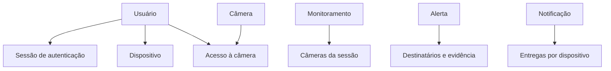
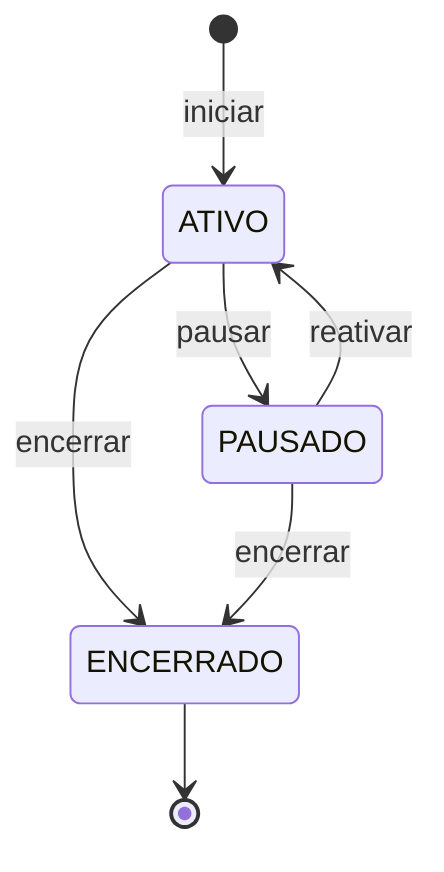
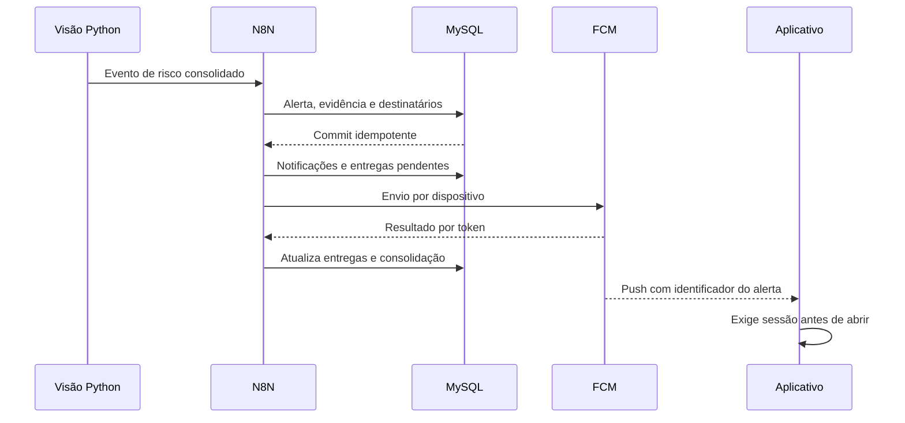

# PoolSafe - Modelo de Domínio

> Especificação canônica dos conceitos, comportamentos, invariantes e limites transacionais do MVP do PoolSafe.

**Versão:** 1.1  
**Status:** aprovado e atualizado após a implementação da Fatia 6  
**Última consolidação:** 3 de outubro de 2026 — 18h56  
**Documentos superiores:** `POOLSAFE_SOURCE_OF_TRUTH.md`, `docs/app-requirements.md` e `docs/database-schema.md`

## 1. Finalidade

Este documento traduz os requisitos do produto e o schema lógico para regras executáveis pela aplicação. Ele responde:

- quais conceitos possuem identidade e ciclo de vida;
- quais objetos precisam permanecer consistentes em conjunto;
- quais ações podem alterar o sistema;
- quais consultas alimentam o aplicativo;
- quem pode realizar cada operação;
- quais regras exigem transação, idempotência ou controle de concorrência;
- quais responsabilidades pertencem à API Node.js, ao N8N e aos demais componentes.

Este documento não define endpoints, JSON, códigos HTTP, classes concretas, framework, ORM ou DDL. Essas decisões pertencem ao `api-contract.md` e às futuras migrações.

## 2. Ordem de autoridade

Quando houver dúvida, deve ser aplicada esta ordem:

1. decisão posterior explicitamente aprovada pela equipe;
2. `POOLSAFE_SOURCE_OF_TRUTH.md`, para arquitetura e fronteiras gerais;
3. `docs/database-schema.md`, para persistência e relacionamentos;
4. este `docs/domain-model.md`, para comportamento e invariantes;
5. `docs/app-requirements.md`, para jornadas e experiência esperada;
6. `docs/api-contract.md`, para representação HTTP das regras aprovadas;
7. diagramas acadêmicos e documentos históricos.

O contrato da API não poderá alterar silenciosamente o domínio para facilitar um endpoint. Caso uma necessidade de implementação contradiga este documento ou o schema, a decisão deve ser revista antes do código.

## 3. Princípios do domínio

1. O PoolSafe comunica uma **possível situação de risco**, não confirma afogamento.
2. Falha, ausência ou desatualização de dados nunca significa segurança.
3. Um usuário acessa somente câmeras autorizadas e alertas dos quais foi destinatário.
4. O alerta é um fato imutável; não possui estados de leitura, verificação ou resolução no MVP.
5. A autorização histórica do alerta não muda quando o acesso atual à câmera é revogado.
6. A evidência é sensível, opcional para a experiência e temporária.
7. Alterações em sessões compartilhadas precisam ser auditáveis.
8. Chamadas repetidas por retry não podem duplicar alertas, destinatários ou entregas.
9. O aplicativo mobile nunca executa regras diretamente no banco, no N8N ou no serviço Python.
10. Segurança, autorização e integridade devem ser aplicadas no servidor, independentemente da interface.

## 4. Linguagem comum

| Termo | Significado no PoolSafe |
|---|---|
| Usuário | Pessoa responsável que possui uma conta no aplicativo |
| Dispositivo | Instalação do aplicativo vinculada a um usuário |
| Câmera | Origem de vídeo cadastrada administrativamente |
| Acesso à câmera | Período durante o qual um usuário está autorizado a consultar e controlar uma câmera |
| Sessão de monitoramento | Período compartilhado de acompanhamento de uma ou várias câmeras |
| Estado solicitado | `ATIVO`, `PAUSADO` ou `ENCERRADO`, persistido na sessão |
| Estado operacional | Situação calculada para a interface: ativo, pausado, degradado ou indisponível |
| Evento de risco | Mensagem técnica consolidada pelo serviço de visão e enviada ao N8N |
| Alerta | Registro imutável de uma possível situação de risco aceita pelo PoolSafe |
| Destinatário | Usuário com acesso ativo à câmera quando o alerta foi criado |
| Evidência | Frame sensível associado ao momento da detecção |
| Notificação | Comunicação lógica de um alerta para um destinatário |
| Entrega | Tentativa de enviar uma notificação a um dispositivo pelo FCM |
| Reautenticação | Nova comprovação da senha antes de uma operação sensível |

“Ativar” na interface pode representar dois comandos diferentes: iniciar uma nova sessão ou reativar uma sessão pausada. A aplicação deve diferenciá-los.

## 5. Módulos do domínio

| Módulo | Responsabilidade |
|---|---|
| Identidade e acesso | conta, senha, autenticação, recuperação e situação do usuário |
| Dispositivos | instalações do app, FCM Token e elegibilidade para push |
| Câmeras e autorizações | cadastro funcional da câmera e períodos de acesso |
| Monitoramento | composição e transições da sessão compartilhada |
| Alertas | aceite idempotente do evento, evidência e destinatários históricos |
| Notificações | preparação da mensagem e entregas por dispositivo |
| Operação e retenção | logs seguros, expurgo e rastreabilidade técnica |

Esses módulos são limites conceituais dentro da mesma solução. Eles não exigem microsserviços separados.

## 6. Visão dos agregados

Um agregado define quais objetos precisam ser modificados de maneira consistente sob uma raiz. Referências entre agregados devem usar identificadores, não árvores inteiras de objetos.

| Agregado | Raiz | Conteúdo protegido pela raiz |
|---|---|---|
| Usuário | `Usuario` | perfil, status e credencial derivada |
| Sessão de autenticação | `SessaoAutenticacao` | validade, uso e revogação |
| Dispositivo | `Dispositivo` | instalação, plataforma, token e situação |
| Câmera | `Camera` | identidade funcional e última comunicação |
| Acesso à câmera | `AcessoCamera` | intervalo de concessão de um usuário a uma câmera |
| Monitoramento | `Monitoramento` | câmeras fixas e eventos de transição |
| Alerta | `Alerta` | evidência e destinatários históricos |
| Notificação | `Notificacao` | entregas aos dispositivos e estado consolidado |

`LogSistema` e registros de recuperação de senha são recursos operacionais com ciclo de vida próprio. Não comandam o estado de outros agregados.

## 7. Agregados e invariantes

### 7.1 Usuário

**Raiz:** `Usuario`  
**Tabela principal:** `usuario`

Responsabilidades:

- representar a identidade da conta;
- manter nome, e-mail normalizado e status;
- aceitar troca da credencial derivada, nunca senha em texto puro;
- impedir autenticação quando bloqueado ou desativado.

Invariantes:

- o e-mail normalizado é obrigatório e único;
- `senha_hash` precisa ter sido produzido pelo mecanismo de hash aprovado;
- `DESATIVADO` exige `desativado_em`;
- somente `ATIVO` pode criar uma nova sessão autenticada;
- bloqueio e desativação não apagam histórico;
- mensagens públicas de autenticação não revelam se um e-mail existe.

Ao redefinir a senha por recuperação ou desativar a conta, todas as sessões de autenticação devem ser revogadas. Para impedir push com conteúdo sensível em instalações possivelmente comprometidas, os dispositivos ativos também devem ser invalidados e precisarão ser registrados novamente após novo login.

Na alteração de senha realizada dentro de uma sessão autenticada, a senha atual precisa ser confirmada. A sessão e o dispositivo usados na operação podem permanecer ativos; todas as outras sessões são revogadas e os demais dispositivos são invalidados.

### 7.2 Sessão de autenticação

**Raiz:** `SessaoAutenticacao`  
**Tabela:** `sessao_autenticacao`

Uma sessão é utilizável somente quando:

- pertence a um usuário `ATIVO`;
- ainda não expirou;
- não foi revogada;
- o segredo apresentado corresponde ao hash persistido.

O segredo bruto nunca retorna em consultas e nunca é registrado em logs. Logout revoga a sessão utilizada e inativa a instalação correspondente. A estratégia concreta de access token e renovação será definida no contrato de autenticação.

### 7.3 Dispositivo

**Raiz:** `Dispositivo`  
**Tabela:** `dispositivo`

Invariantes:

- `identificador_instalacao` identifica uma instalação dentro da conta;
- uma mesma combinação usuário/instalação possui um único registro;
- um FCM Token pertence a apenas uma instalação por vez;
- dispositivo elegível para push precisa estar ativo e possuir FCM Token;
- token renovado substitui o anterior de maneira transacional;
- falha definitiva informada pelo FCM invalida o token;
- histórico de entregas permanece associado após invalidação.

Registrar novamente a mesma instalação é uma operação idempotente de atualização, não a criação de dispositivos ilimitados.

### 7.4 Câmera

**Raiz:** `Camera`  
**Tabela:** `camera`

A câmera contém apenas dados funcionais necessários à aplicação. IP, URL de stream, protocolo, credenciais e configuração do gateway não pertencem a este agregado.

Invariantes:

- `codigo_integracao` é estável e único;
- câmera inativa não inicia nem reativa monitoramento;
- a última comunicação somente avança no tempo, salvo correção administrativa explícita;
- o estado de conexão é calculado, não persistido.

Política de conectividade do MVP:

| Resultado | Condição |
|---|---|
| `DESCONHECIDA` | nunca comunicou ou a referência temporal não é confiável |
| `ONLINE` | última comunicação dentro da janela configurada de 90 segundos |
| `OFFLINE` | câmera ativa fora da janela de 90 segundos |
| `INATIVA` | situação administrativa; não deve ser confundida com falha de rede |

A atualização frequente de heartbeat não precisa gerar um evento de domínio persistido a cada ocorrência.

### 7.5 Acesso à câmera

**Raiz:** `AcessoCamera`  
**Tabela:** `acesso_camera`

Invariantes:

- somente a administração concede ou revoga acesso no MVP;
- não podem existir dois períodos ativos para o mesmo par usuário/câmera;
- revogação preenche `revogado_em` e preserva o período histórico;
- acesso ativo autoriza a câmera, mas não substitui autenticação válida;
- papéis como proprietário e convidado não existem no MVP.

Alterações em câmeras pertencentes a um monitoramento não encerrado precisam preservar o mesmo conjunto de usuários ativos para todas as câmeras da sessão. Se a composição de acesso mudar, a operação administrativa deve:

1. aplicar a mesma mudança a todas as câmeras da sessão; ou
2. encerrar a sessão existente e criar outra com a nova composição.

Uma revogação não pode deixar câmera de sessão ativa sem qualquer usuário autorizado. O sistema deve pausar ou encerrar a sessão antes da última revogação.

### 7.6 Monitoramento

**Raiz:** `Monitoramento`  
**Conteúdo:** `MonitoramentoCamera` e `EventoMonitoramento`  
**Tabelas:** `monitoramento`, `monitoramento_camera` e `evento_monitoramento`

Invariantes estruturais:

- uma sessão contém uma ou várias câmeras;
- a composição de câmeras é imutável depois do início;
- todas as câmeras precisam estar administrativamente ativas;
- cada câmera precisa ter ao menos um acesso ativo;
- as câmeras da sessão devem compartilhar o mesmo conjunto de usuários autorizados;
- uma câmera participa de no máximo uma sessão `ATIVA` ou `PAUSADA`;
- o ator precisa ter acesso ativo a todas as câmeras da sessão;
- cada transição cria um evento de monitoramento na mesma transação;
- `ENCERRADO` é terminal.

Transições:

Regras por comando:

- **Iniciar:** não pode haver outra sessão não encerrada para nenhuma câmera escolhida; todas devem estar online no instante da validação.
- **Pausar:** exige usuário autorizado, sessão ativa, aviso apresentado pelo cliente e reautenticação por senha validada pela API na mesma operação.
- **Reativar:** exige sessão pausada, usuário autorizado e todas as câmeras online.
- **Encerrar:** pode ser executado por usuário reautenticado com acesso ativo a todas as câmeras, pela administração ou pelo sistema; nunca pode ser desfeito. A operação preserva a composição e o histórico, preenche o instante de encerramento, registra um único evento `ENCERRADO` e libera as câmeras para novas sessões.

Não existe desvinculação individual de câmera em uma sessão iniciada. Para alterar a composição, a sessão atual deve ser encerrada e outra deve ser criada com o novo conjunto de câmeras.

A perda de conexão depois do início não pausa automaticamente a sessão. Ela altera o estado operacional calculado para degradado ou indisponível e precisa ser comunicada ao usuário.

### 7.7 Alerta

**Raiz:** `Alerta`  
**Conteúdo:** `EvidenciaAlerta` e `AlertaDestinatario`  
**Tabelas:** `alerta`, `evidencia_alerta` e `alerta_destinatario`

O alerta nasce de um evento técnico já consolidado pelo backend de visão. A lógica de detecção por YOLOv11, ByteTrack e persistência temporal não pertence a este agregado.

Invariantes:

- `chave_evento` identifica o evento de forma global e idempotente;
- o N8N precisa resolver exatamente um monitoramento `ATIVO` que contenha a câmera;
- o evento técnico não informa nem precisa conhecer o identificador interno do monitoramento;
- `detectado_em` representa o instante na origem e `criado_em` o recebimento;
- confiança, quando presente, fica entre zero e um;
- tipo e severidade pertencem aos vocabulários aceitos;
- o alerta não pode ser editado como “visualizado”, “verificado” ou “resolvido”;
- destinatários são copiados dos acessos ativos da câmera no instante do alerta;
- revogação posterior não remove o alerta do histórico do destinatário;
- existe no máximo uma evidência por alerta no MVP;
- ausência ou expiração da evidência não invalida o alerta.

Se uma falha de configuração produzir um alerta sem destinatários, o alerta deve ser preservado para rastreabilidade, a distribuição deve ficar vazia e um erro operacional de alta prioridade deve ser registrado. Esse caso é uma exceção de segurança, não um resultado normal.

### 7.8 Evidência do alerta

`EvidenciaAlerta` existe dentro do agregado de alerta, mas seu conteúdo é carregado somente quando necessário.

Invariantes:

- somente JPEG ou PNG aceitos pela política do MVP;
- bytes são armazenados diretamente, nunca como Base64 no banco;
- tamanho e hash correspondem ao conteúdo recebido;
- enquanto disponível, `conteudo` está preenchido e `removida_em` está nulo;
- ao expirar ou ser removida por privacidade, o conteúdo é zerado e `removida_em` preenchido na mesma transação;
- somente destinatário autenticado do alerta pode obtê-la pela API.

### 7.9 Notificação

**Raiz:** `Notificacao`  
**Conteúdo:** `EntregaNotificacao`  
**Tabelas:** `notificacao` e `entrega_notificacao`

Uma notificação pertence a exatamente um par alerta/destinatário. Seu texto é um snapshot para que mudanças futuras de microcopy não alterem o histórico de envio.

Invariantes:

- existe no máximo uma notificação lógica por alerta e usuário;
- somente dispositivos ativos do destinatário, com token presente, recebem entregas;
- existe no máximo uma entrega por notificação e dispositivo;
- cada tentativa incrementa o contador e atualiza o instante correspondente;
- uma falha definitiva de token invalida também o token do dispositivo;
- `ENVIADA` significa aceite pelo FCM, não leitura ou exibição no celular;
- o estado geral é consolidado a partir das entregas e pode mudar após retry.

Consolidação:

| Estado | Regra |
|---|---|
| `PENDENTE` | entregas ainda não concluídas |
| `SEM_DISPOSITIVO` | nenhum dispositivo elegível existia |
| `PROCESSADA` | todas as entregas foram aceitas pelo FCM |
| `PARCIAL` | ao menos uma aceita e ao menos uma falhou |
| `FALHA` | nenhuma entrega foi aceita |

Retries atuam sobre a entrega existente; não criam outra notificação nem outra entrega para o mesmo dispositivo.

## 8. Objetos de valor e políticas

| Objeto ou política | Regra essencial |
|---|---|
| `EmailNormalizado` | formato válido, espaços removidos nas extremidades e minúsculas |
| `SenhaEmTexto` | transitória, nunca persistida ou logada |
| `SenhaHash` | produzida e verificada por serviço criptográfico aprovado |
| `TokenHash` | representação persistida de segredo de sessão ou recuperação |
| `CodigoIntegracaoCamera` | não vazio, estável e único |
| `ChaveEvento` | não vazia, estável e idempotente |
| `ConfiancaDeteccao` | decimal entre `0.0000` e `1.0000` |
| `InstanteUtc` | data com precisão de milissegundos normalizada em UTC |
| `TipoAlerta` | vocabulário controlado; inicial `POSSIVEL_RISCO` |
| `SeveridadeAlerta` | `ATENCAO` ou `CRITICA` |
| `EstadoConexaoCamera` | resultado calculado pela política de 90 segundos |
| `EstadoOperacional` | resumo calculado para Home e detalhes |
| `FcmToken` | valor sensível, renovável e exclusivo de uma instalação |
| `MetadadosEvidencia` | MIME type, tamanho, hash e expiração coerentes |

Esses conceitos podem virar tipos, schemas ou classes conforme a stack escolhida, mas suas regras não devem ser repetidas de maneira divergente em vários pontos do código.

## 9. Estado operacional calculado

O status persistido do monitoramento e o estado apresentado na interface não são a mesma coisa. Primeiro, a política calcula o resultado de cada sessão:

| Condição | Estado operacional | Motivo sugerido |
|---|---|---|
| nenhuma sessão atual | `INDISPONIVEL` | `SEM_SESSAO` |
| sessão `PAUSADA` | `PAUSADO` | `PAUSADO_PELO_USUARIO` |
| sessão `ATIVA` e todas as câmeras online | `ATIVO` | `OPERACIONAL` |
| sessão `ATIVA` e parte das câmeras online | `DEGRADADO` | `CAMERAS_INDISPONIVEIS` |
| sessão `ATIVA` e nenhuma câmera online | `INDISPONIVEL` | `SEM_CAMERA_ONLINE` |
| falha ao consultar dados confiáveis | não é estado de domínio | cliente apresenta `NAO_VERIFICADO` |

Quando o usuário participa de mais de uma sessão atual, a Home calcula um resumo global:

| Conjunto de sessões do usuário | Estado global |
|---|---|
| nenhuma sessão atual | `INDISPONIVEL` |
| todas pausadas | `PAUSADO` |
| todas ativas e operacionais | `ATIVO` |
| mistura de sessões ativas (com ao menos uma câmera online) e pausadas, ou alguma sessão degradada | `DEGRADADO` |
| todas as sessões ativas indisponíveis (sem nenhuma câmera online), independentemente de haver sessões pausadas | `INDISPONIVEL` |

O resumo nunca esconde os resultados individuais. Se todas as sessões ativas estiverem com suas câmeras offline, nenhuma vigilância ativa está ocorrendo no mundo real; logo, a coexistência com sessões pausadas não qualifica proteção parcial (`DEGRADADO`), prevalecendo o estado global `INDISPONIVEL` com motivo `SEM_CAMERA_ONLINE`. A condição `DEGRADADO / SESSIONS_MIXED` (apresentada na Home como “Proteção parcial” com badge de atenção em amarelo) exige que ao menos uma sessão ativa possua câmeras transmitindo sinal. A resposta da Home precisa incluir o horário de referência e a quantidade de sessões por condição. Dados em cache podem ser apresentados como última informação conhecida, mas não confirmam a situação atual. Avisos operacionais (`warnings`) reportados na Home são consolidados por categoria de pendência (no máximo um aviso por tipo/código), com mensagens voltadas ao escopo agregado do usuário ("Uma ou mais câmeras associadas..."), evitando poluição visual com cartões redundantes.

## 10. Autorização

Autenticação responde quem é o ator; autorização decide se ele pode agir sobre um recurso específico.

| Operação | Regra de autorização |
|---|---|
| consultar perfil | próprio usuário autenticado |
| alterar nome ou senha | próprio usuário autenticado; senha segue política de confirmação |
| registrar dispositivo | próprio usuário autenticado |
| listar/ver câmera | `acesso_camera` ativo para a câmera |
| iniciar sessão | acesso ativo a todas as câmeras escolhidas |
| pausar/reativar sessão | acesso ativo a todas as câmeras da sessão; pausa exige reautenticação |
| consultar alerta | existência de `alerta_destinatario` para o usuário |
| obter evidência | destinatário do alerta, conta ativa e evidência disponível |
| conceder/revogar câmera | administração, fora do app MVP |
| encerrar monitoramento | usuário reautenticado com acesso ativo a todas as câmeras, administração ou processo interno autorizado |
| registrar alerta | identidade interna autorizada do workflow N8N |
| consultar logs | operação administrativa; nunca aplicativo comum |

Não possuir acesso atual à câmera não elimina o acesso a alertas históricos recebidos enquanto a autorização estava ativa. Conta bloqueada ou desativada não consegue se autenticar para exercer esse direito.

## 11. Comandos do sistema

Comando representa intenção de alterar estado. Os nomes abaixo são conceituais e não determinam rotas HTTP.

| Comando | Ator | Resultado principal |
|---|---|---|
| `CadastrarUsuario` | público | usuário ativo com senha protegida |
| `AutenticarUsuario` | público | nova sessão autenticada |
| `EncerrarSessao` | usuário | sessão revogada e instalação inativada |
| `SolicitarRecuperacaoSenha` | público | resposta genérica e token interno quando aplicável |
| `RedefinirSenha` | público com token | nova senha, token consumido e acessos autenticados revogados |
| `AtualizarNomeUsuario` | usuário | perfil atualizado |
| `AlterarSenha` | usuário com senha atual | nova senha, outras sessões revogadas e outros dispositivos invalidados |
| `RegistrarDispositivo` | usuário | instalação criada ou atualizada idempotentemente |
| `AtualizarTokenFcm` | usuário | token reassociado à instalação atual |
| `InvalidarDispositivo` | usuário ou sistema | instalação removida da elegibilidade de push |
| `RegistrarComunicacaoCamera` | serviço interno | última comunicação avançada |
| `ConcederAcessoCamera` | administração | novo período ativo de acesso |
| `RevogarAcessoCamera` | administração | período encerrado sem apagar histórico |
| `IniciarMonitoramento` | usuário autorizado | sessão ativa com composição imutável |
| `PausarMonitoramento` | usuário reautenticado | sessão pausada e evento auditado |
| `ReativarMonitoramento` | usuário autorizado | sessão ativa e evento auditado |
| `EncerrarMonitoramento` | usuário reautenticado, administração ou sistema | sessão encerrada definitivamente, histórico preservado e câmeras liberadas |
| `RegistrarAlerta` | N8N | alerta idempotente, evidência e destinatários |
| `PrepararNotificacoes` | N8N | notificações e entregas pendentes |
| `RegistrarResultadoEntrega` | N8N | entrega e estado consolidado atualizados |
| `ExpurgarDadosExpirados` | rotina interna | conteúdo e registros removidos conforme retenção |

### 11.1 Semântica da ativação

Quando o usuário pede para “ativar”:

- se existe sessão `PAUSADA`, o caso de uso executa `ReativarMonitoramento`;
- se não existe sessão não encerrada, executa `IniciarMonitoramento`;
- se já existe sessão `ATIVA`, a resposta é idempotente e retorna o estado atual;
- se existe conflito de composição ou autorização, nenhuma nova sessão é criada.

O `api-contract.md` decidirá como a lista de câmeras será informada ou resolvida, sem alterar as invariantes deste documento.

### 11.2 Semântica do encerramento pelo usuário

O encerramento solicitado pelo aplicativo:

- exige sessão `ATIVA` ou `PAUSADA` e acesso ativo do ator a todas as câmeras;
- exige confirmação da senha atual na mesma operação;
- é terminal e afeta a sessão inteira;
- preenche `encerrado_em` e grava `ENCERRADO` na mesma transação;
- preserva `monitoramento_camera`, eventos e alertas associados;
- torna as câmeras elegíveis para novas sessões somente depois do commit;
- é idempotente e não cria eventos duplicados quando repetido;
- não pode ser usado como atalho para alterar fisicamente a composição histórica.

## 12. Consultas e modelos de leitura

Consultas não alteram o domínio e podem produzir modelos otimizados para a interface.

| Consulta | Conteúdo mínimo |
|---|---|
| `ObterPerfilAtual` | nome, e-mail e dados editáveis |
| `ObterResumoHome` | estado global, sessões atuais, contagem online/total, referência temporal e alerta recente |
| `ListarCamerasAutorizadas` | nome, local, conexão, sessão atual e última comunicação |
| `ObterDetalhesCamera` | dados funcionais, monitoramento e alertas recentes autorizados |
| `ObterMonitoramentoAtual` | status persistido, estado operacional, câmeras e última transição |
| `ListarHistoricoAlertas` | alertas do destinatário em ordem decrescente e cursor de paginação |
| `ObterDetalhesAlerta` | tipo, severidade, detecção, câmera, notificação e disponibilidade de evidência |
| `ObterEvidenciaAlerta` | binário autorizado com MIME type e controles de cache apropriados |
| `ObterSituacaoDispositivo` | registro do dispositivo e elegibilidade para push |

Regras para os modelos de leitura:

- nunca retornar credenciais, hashes, FCM Token, IP ou URL de stream;
- confiança, versão do modelo e dados técnicos não são necessários no DTO comum do aplicativo;
- histórico usa `alerta_destinatario`, não o acesso atual à câmera;
- paginação deve ser estável mesmo quando novos alertas entram; o contrato deverá preferir cursor;
- ausência de evidência não impede retorno dos metadados do alerta.

## 13. Eventos de domínio e auditoria

Os nomes abaixo expressam fatos ocorridos. Não implicam adoção de broker ou arquitetura de event sourcing.

| Evento | Uso |
|---|---|
| `UsuarioCadastrado` | auditoria e fluxo de boas-vindas futuro |
| `SenhaRedefinida` | revogar sessões e dispositivos |
| `DispositivoRegistrado` | rastrear instalação elegível |
| `TokenFcmAtualizado` | substituir vínculo anterior |
| `TokenFcmInvalidado` | impedir novas tentativas definitivas |
| `AcessoCameraConcedido` | auditoria administrativa |
| `AcessoCameraRevogado` | auditoria e validação da sessão compartilhada |
| `MonitoramentoIniciado` | corresponde ao evento `INICIADO` |
| `MonitoramentoPausado` | corresponde ao evento `PAUSADO` |
| `MonitoramentoReativado` | corresponde ao evento `REATIVADO` |
| `MonitoramentoEncerrado` | corresponde ao evento `ENCERRADO` |
| `AlertaRegistrado` | inicia preparação de destinatários e notificações |
| `DestinatariosAlertaDefinidos` | congela autorização histórica |
| `NotificacaoPreparada` | libera entregas após commit |
| `EntregaNotificacaoAceita` | FCM aceitou a mensagem |
| `EntregaNotificacaoFalhou` | retry ou invalidação necessária |
| `EvidenciaRemovida` | auditoria da política de retenção |

Somente as transições do monitoramento possuem uma tabela de evento de domínio dedicada no schema atual. Os demais fatos podem ser representados pelo próprio estado persistido e por logs seguros quando necessário.

## 14. Fluxo do alerta

Regras do fluxo:

1. o backend Python não acessa o MySQL;
2. o N8N autentica e valida o evento antes de persistir;
3. alerta, evidência válida e destinatários são persistidos de modo idempotente;
4. notificações e entregas existem antes da chamada externa ao FCM;
5. nenhuma transação fica aberta durante a chamada de rede;
6. o aplicativo usa o identificador recebido apenas para consultar a API;
7. a API revalida autenticação e autorização; o push não concede acesso.

## 15. Transações, concorrência e idempotência

| Cenário | Proteção obrigatória |
|---|---|
| iniciar sessão com câmeras | transação e bloqueio/constraint que impeça outra sessão não encerrada |
| alterar estado do monitoramento | bloquear ou versionar a sessão; validar transição dentro da transação |
| pausar monitoramento | validar reautenticação antes; estado e evento são gravados juntos |
| encerrar monitoramento | validar autorização e reautenticação; estado terminal, instante e evento são gravados juntos |
| conceder/revogar acesso | impedir períodos ativos duplicados e preservar consistência da sessão |
| renovar FCM Token | remover vínculo anterior e associar o atual na mesma transação |
| receber evento de risco repetido | `chave_evento` retorna o alerta já existente |
| definir destinatários | inserção única por alerta/usuário |
| preparar notificação | inserção única por alerta/usuário |
| preparar entrega | inserção única por notificação/dispositivo |
| consumir token de recuperação | verificar validade e marcar uso atomicamente |
| expurgar evidência | zerar conteúdo e marcar remoção na mesma transação |

Idempotência não significa repetir efeitos colaterais. Ao receber novamente a mesma `chave_evento`, o workflow pode completar etapas pendentes, mas não reenviar automaticamente entregas já aceitas pelo FCM.

## 16. Categorias de falha do domínio

Essas categorias orientarão o futuro envelope de erros da API.

| Categoria | Exemplo |
|---|---|
| validação | e-mail inválido ou lista de câmeras vazia |
| não autenticado | sessão ausente, expirada ou revogada |
| acesso negado | câmera sem acesso ativo ou alerta de outro destinatário |
| não encontrado | recurso inexistente dentro do escopo autorizado |
| conflito | FCM Token ligado a outra atualização concorrente |
| transição inválida | pausar sessão já encerrada |
| reautenticação exigida | pausa ou encerramento sem confirmação válida de senha |
| dependência indisponível | FCM ou serviço interno temporariamente inacessível |
| dados expirados | alerta ou evidência já removidos pela retenção |
| configuração inconsistente | alerta sem destinatários ou sessão com acessos divergentes |

Para recursos protegidos, “não encontrado” pode ser preferível a revelar que o recurso existe mas pertence a outro usuário. O mapeamento para códigos HTTP será definido no contrato da API.

## 17. Serviços de domínio e de aplicação

Serviços conceituais necessários:

| Serviço | Responsabilidade |
|---|---|
| `ServicoHashSenha` | produzir e verificar hashes sem expor detalhes ao domínio |
| `PoliticaAutorizacaoCamera` | verificar acesso ativo e composição compartilhada |
| `PoliticaConectividadeCamera` | calcular conexão pela janela de 90 segundos |
| `PoliticaEstadoOperacional` | combinar sessão e câmeras para a Home |
| `ServicoControleMonitoramento` | coordenar autorização, transição e auditoria |
| `ServicoRegistroAlerta` | validar origem, garantir idempotência e congelar destinatários |
| `ServicoPreparacaoNotificacao` | criar mensagem lógica e entregas elegíveis |
| `ServicoConsolidacaoEntrega` | derivar status geral das entregas |
| `PoliticaRetencao` | selecionar e remover dados expirados em lotes |

Interfaces de persistência podem ser organizadas por agregado, como `RepositorioUsuario`, `RepositorioDispositivo`, `RepositorioCamera`, `RepositorioAcessoCamera`, `RepositorioMonitoramento`, `RepositorioAlerta` e `RepositorioNotificacao`. Seus métodos devem expressar casos de uso, evitando um repositório genérico que permita ignorar invariantes.

## 18. Fronteiras entre componentes

### API Node.js

- executa autenticação e autorização do aplicativo;
- implementa comandos e consultas voltados ao usuário;
- controla sessões, dispositivos e transições do monitoramento;
- entrega histórico e evidências autorizadas;
- não executa visão computacional;
- é proprietária preferencial das migrações do schema.

### Backend Python

- captura e analisa o vídeo;
- consolida tecnicamente o evento de risco;
- envia o evento autenticado ao N8N;
- não acessa o banco nem decide destinatários.

### N8N

- implementa o caso de uso interno de registro do alerta;
- resolve destinatários a partir de `acesso_camera`;
- prepara e envia notificações;
- registra resultados e falhas;
- respeita o schema e as invariantes deste documento;
- não oferece endpoints diretamente ao aplicativo.

### Aplicativo React Native

- apresenta estado e coleta intenções;
- nunca assume sucesso antes da confirmação da API;
- não decide autorização nem conexão da câmera;
- trata o push como convite para consultar um recurso protegido.

## 19. Retenção e privacidade

- alertas, destinatários, notificações e entregas permanecem por 30 dias no MVP;
- evidência expira em 30 dias ou antes por decisão de privacidade;
- logs operacionais permanecem por 30 dias;
- limpeza ocorre em lotes e com rastreabilidade;
- consultas a dados removidos retornam indisponibilidade segura, não erro interno;
- evidências não devem ser persistidas localmente pelo aplicativo além do necessário;
- logs não contêm senha, token, imagem, credencial ou payload sensível completo.

O direito futuro de exclusão de conta exigirá política específica de anonimização ou remoção. Ele não deve ser improvisado sobre o MVP.

## 20. Mapeamento entre domínio e schema

| Conceito de domínio | Persistência |
|---|---|
| `Usuario` | `usuario` |
| `SessaoAutenticacao` | `sessao_autenticacao` |
| recuperação de senha | `token_recuperacao_senha` |
| `Dispositivo` | `dispositivo` |
| `Camera` | `camera` |
| `AcessoCamera` | `acesso_camera` |
| `Monitoramento` | `monitoramento` |
| câmeras da sessão | `monitoramento_camera` |
| auditoria de transição | `evento_monitoramento` |
| `Alerta` | `alerta` |
| `EvidenciaAlerta` | `evidencia_alerta` |
| `AlertaDestinatario` | `alerta_destinatario` |
| `Notificacao` | `notificacao` |
| `EntregaNotificacao` | `entrega_notificacao` |
| operação e diagnóstico | `log_sistema` |

O mapeamento não exige que classes e tabelas tenham exatamente a mesma forma. DTOs da API, modelos do ORM e objetos de domínio são representações diferentes e não devem ser tratados como sinônimos.

## 21. Fora do domínio do MVP

- reprodução ou streaming ao vivo;
- cadastro e pareamento de câmeras pelo usuário;
- edição de IP, protocolo ou credenciais de câmera;
- papéis de proprietário, convidado ou permissões granulares;
- confirmação, resolução ou reconhecimento de incidentes;
- marcação de alerta como visualizado;
- escalonamento automático para emergência;
- agendamento de horários de monitoramento;
- preferências avançadas de som, vibração e canais;
- múltiplas evidências ou vídeo por alerta;
- configuração do modelo de IA pelo aplicativo;
- Firestore ou Firebase Realtime Database.

## 22. Regras para o Antigravity

Ao implementar este domínio, o agente deve:

1. consultar este documento antes de criar casos de uso, entidades ou serviços;
2. consultar `database-schema.md` antes de criar ou alterar migrations;
3. não transformar o model do ORM em única camada de regras;
4. centralizar invariantes críticas e testá-las;
5. não adicionar estados de alerta não aprovados;
6. aplicar autorização no servidor em toda consulta protegida;
7. preservar transações e idempotência descritas aqui;
8. não expor campos técnicos ou sensíveis nos DTOs por conveniência;
9. interromper a implementação se um requisito exigir mudança estrutural não aprovada;
10. atualizar domínio, schema, contrato e testes quando uma decisão aprovada mudar.

## 23. Cenários mínimos de teste do domínio

- rejeitar cadastro com e-mail normalizado já existente;
- impedir login de usuário bloqueado ou desativado;
- revogar sessão expirada, logout e recuperação de senha;
- preservar somente a sessão e o dispositivo atuais após alteração autenticada de senha;
- renovar FCM Token sem deixar o mesmo token em dois dispositivos;
- impedir dois acessos ativos para o mesmo usuário e câmera;
- impedir sessão sem câmera, câmera inativa ou câmera offline;
- impedir que a mesma câmera pertença a duas sessões não encerradas;
- impedir controle por usuário sem acesso a todas as câmeras;
- exigir reautenticação ao pausar e encerrar pelo aplicativo;
- registrar transição e evento de monitoramento atomicamente;
- preservar composição e histórico ao encerrar, sem duplicar o evento terminal;
- impedir desvinculação individual ou alteração da composição iniciada;
- calcular ativo, pausado, degradado e indisponível corretamente;
- consolidar corretamente a Home quando houver várias sessões atuais;
- tratar a mesma `chave_evento` sem duplicar alerta;
- congelar destinatários ativos no instante da detecção;
- manter alerta no histórico após revogação posterior;
- negar alerta e evidência de outro destinatário;
- retornar alerta mesmo sem evidência disponível;
- não duplicar notificação ou entrega em retry;
- invalidar FCM Token após falha definitiva;
- não reenviar entrega já aceita em retry do workflow;
- expurgar evidência e registros na ordem segura.

## 24. Entradas para o `api-contract.md`

O próximo documento deverá transformar estes casos de uso em interfaces HTTP e definir:

- autenticação, renovação e revogação de sessão;
- representação pública dos estados e motivos calculados;
- comandos separados para iniciar, pausar, reativar e encerrar quando aplicável;
- reautenticação segura para pausa e encerramento;
- cadastro idempotente de dispositivo e renovação do FCM Token;
- paginação por cursor no Histórico;
- autorização e transmissão da evidência;
- envelopes de sucesso e erro;
- versionamento, datas UTC e validação de entrada;
- contrato interno autenticado do evento Python -> N8N;
- payload mínimo de push com identificador do alerta;
- respostas idempotentes e conflitos de concorrência.

O `api-contract.md` deve representar o domínio; não deve criar novas regras de negócio sem uma decisão explícita.
